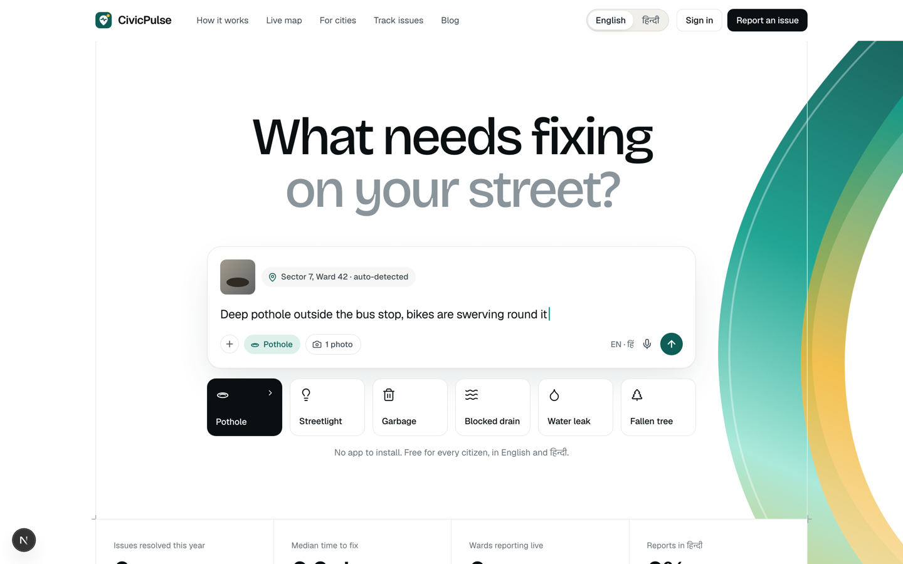
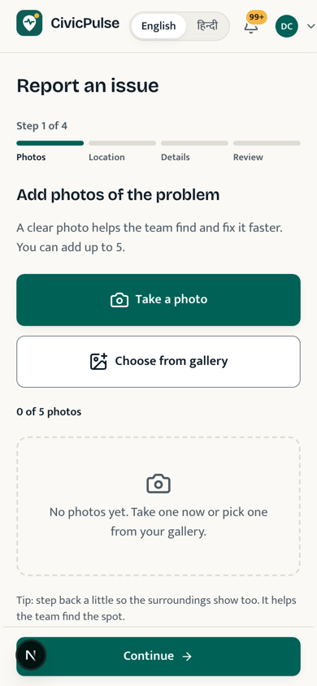
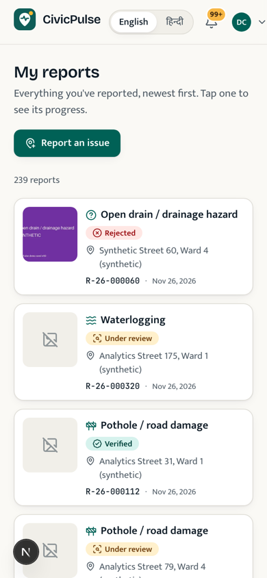
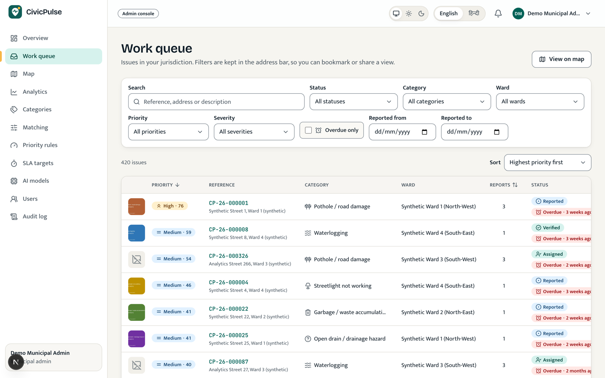
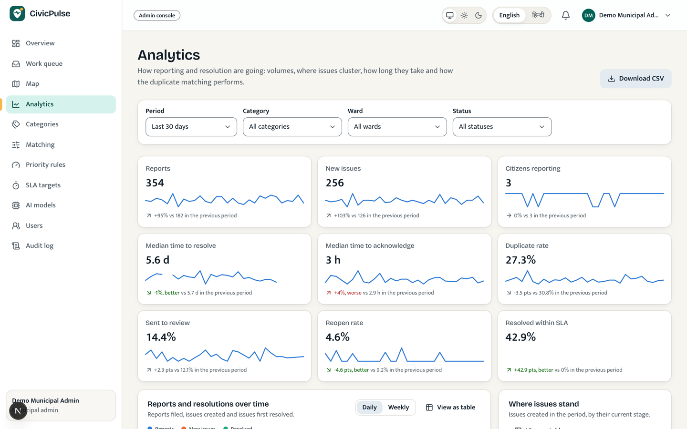
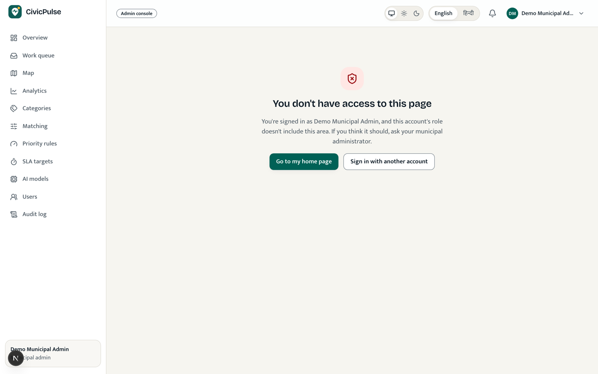
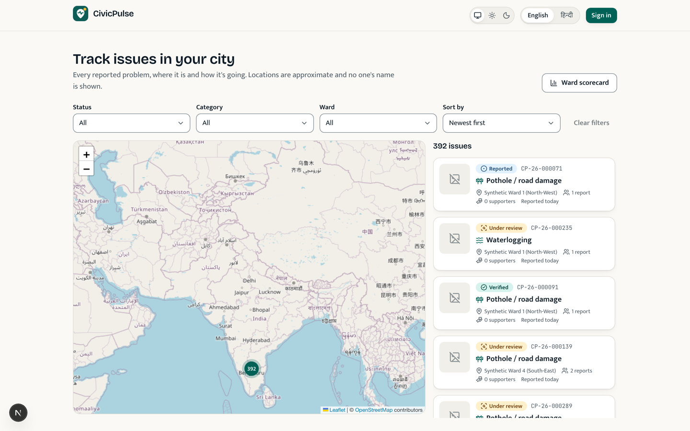
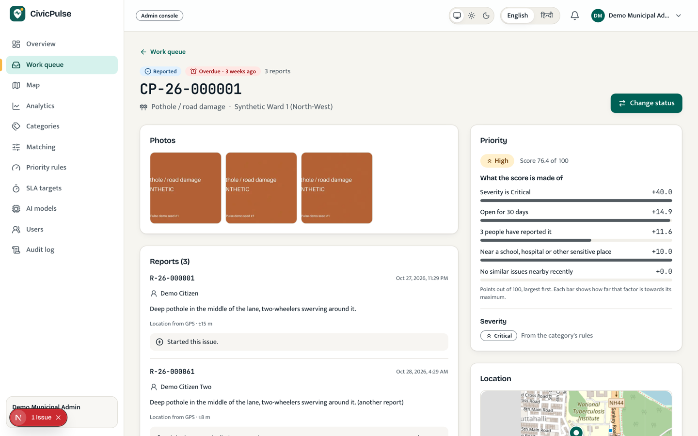
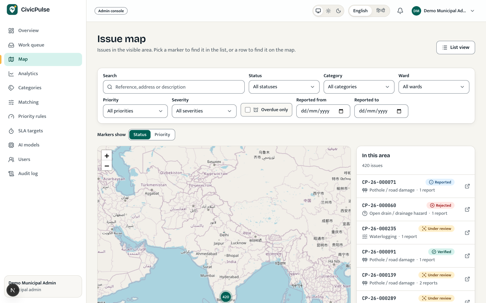
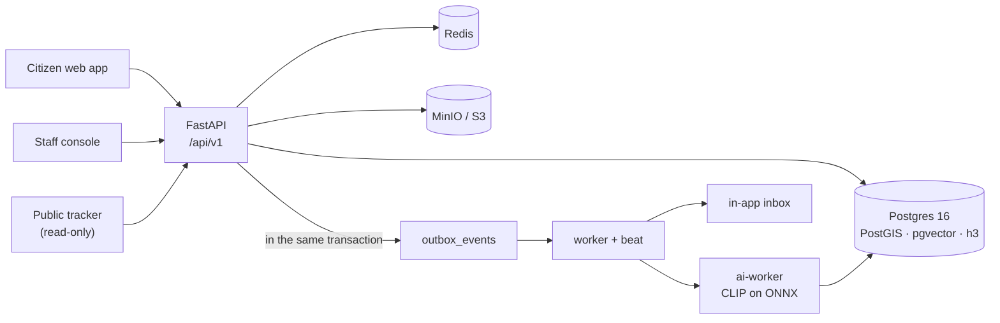

<p align="center">
  
</p>

<h1 align="center">CivicPulse</h1>

<p align="center">
  Citizens photograph a civic problem, the city sees a prioritised work queue,<br>
  and everyone can follow the issue until it is fixed.
</p>

<p align="center">
  <a href="https://github.com/kunal-arora-1411/civic-pulse/actions/workflows/ci.yml"></a>
  
  
  
</p>

CivicPulse is a municipal issue-reporting platform for Indian cities. A citizen sends a photo and a
location from their phone (pothole, overflowing bin, dark streetlight, blocked drain). An on-device-scale
vision model classifies it and links it to an existing issue if the same problem was already reported.
Staff triage from a map and a work queue, work against per-category SLA timers, and close with
photo evidence that the citizen confirms. The whole citizen-facing flow is available in English and
Hindi.

## Screens

<table>
  <tr>
    <td width="50%"></td>
    <td width="50%"></td>
  </tr>
  <tr>
    <td><sub><b>Report in four steps.</b> Photo, then a draggable pin with its accuracy, then category and description.</sub></td>
    <td><sub><b>Follow every report.</b> Status timeline, the AI's suggested category, and community support.</sub></td>
  </tr>
</table>

<table>
  <tr>
    <td width="50%"></td>
    <td width="50%"></td>
  </tr>
  <tr>
    <td><sub><b>Work queue.</b> Priority, SLA state and ward in one table, filtered and sorted server-side.</sub></td>
    <td><sub><b>Analytics.</b> Volumes, resolution times, SLA compliance, hotspots and matching quality.</sub></td>
  </tr>
  <tr>
    <td width="50%"></td>
    <td width="50%"></td>
  </tr>
  <tr>
    <td><sub><b>Review queue.</b> When matching is unsure, an operator decides — with the signals that led to the suggestion.</sub></td>
    <td><sub><b>Public tracker.</b> Anyone can follow the city's issues and its ward scorecard, without signing in.</sub></td>
  </tr>
</table>

<details>
<summary><b>Two more: the issue detail view and the admin map</b></summary>

<br>

<p></p>
<p><sub>Everything about one issue: reports, evidence, timeline, assignments, and the audited history staff work from.</sub></p>

<p></p>
<p><sub>The same queue on a map, clustered and coloured by priority, with ward boundaries.</sub></p>

</details>

## How it works



- **One modular monolith, not a mesh.** Domain modules (`reports`, `issues`, `matching`, `priority`, `sla`,
  `analytics`, …) share a database and a transaction, so a report, its issue and its audit event commit together.
- **Tenant isolation in the database.** Postgres row-level security on `tenant_id`, set per request, rather than
  a `WHERE` clause every developer must remember. Tested with "denied" cases.
- **AI never blocks a report.** The report is accepted immediately; classification and duplicate matching run
  after, and if the AI is down the report is marked pending and routed to manual triage.
- **Side effects leave the transaction.** Notifications and webhooks are written to an outbox and delivered
  by a worker, so a slow SMS provider can never hold a citizen's submission open.
- **Everything important is audited**, with before/after state and the actor.

## Status

Built phase by phase against [`IMPLEMENTATION_PLAN.md`](IMPLEMENTATION_PLAN.md). The API, database and AI
layer are complete through Phase 5; the gaps are mostly screens, delivery channels and hardening.

| Phase | State |
|---|---|
| P0 Foundations | Done — tenancy, OTP auth, RBAC, audit, CI |
| P1 Core reporting loop | Done — reports, media, issues, workflow |
| P2 AI layer | Done — CLIP classification, duplicate matching, review queue, merge/split, priority |
| P3 Operations | API done; **field app and several staff screens outstanding** |
| P4 SLA and notifications | SLA timers and escalation done; **in-app inbox only** — push, email and SMS adapters outstanding |
| P5 Analytics | Dashboard, CSV export, hotspots and public tracker done; **scheduled summaries and the assistant outstanding** |
| P6 Hardening | Not started — offline, voice, security hardening, load testing, retention |

[`docs/STATUS.md`](docs/STATUS.md) tracks the work at task level, and [`docs/team/`](docs/team) has the
per-person plans.

## Repository layout

| Path | What it is |
|---|---|
| `apps/api` | FastAPI service: tenancy with row-level security, OTP sign-in, RBAC, audit, reports, media, issues, matching, priority, SLA, analytics, public tracker. Python 3.12, uv. See [`apps/api/README.md`](apps/api/README.md). |
| `apps/web` | Next.js 16 app: the citizen flow, the staff console and the public tracker, in English and Hindi. |
| `e2e` | Playwright end-to-end tests against the real, seeded stack. Also regenerates the screenshots above. |
| `infra` | Docker Compose for local development: Postgres + PostGIS, Redis, MinIO, Mailpit, API, worker, beat, AI worker. |
| `docs/api` | The API contracts the backend and frontend share. |
| `docs/adr` | Architecture decision records. |
| `docs/metrics.md` | The definition behind every number the analytics shows. |

## Prerequisites

- Docker with Compose v2 (this repo is tested on [Kiri](https://kiri.dev) as well as Docker Desktop)
- Node.js 22+ and pnpm 10 (`corepack enable` picks up the pinned version)
- For API work outside Docker: Python 3.12 and [uv](https://docs.astral.sh/uv/) (`py -3 -m uv` on Windows)

## Quick start

```sh
# 1. Start the stack (API on :8000, with its database, storage and workers)
docker compose -f infra/docker-compose.yml up -d --build --wait

# 2. Load the synthetic demo data (safe to run again)
docker compose -f infra/docker-compose.yml exec -T ai-worker python scripts/seed.py

# 3. Run the web app
pnpm install
pnpm dev
```

| URL | |
|---|---|
| <http://localhost:3000> | Web app (citizen pages; staff go to `/admin`) |
| <http://localhost:8000/docs> | API reference (Swagger UI) |
| <http://localhost:9001> | MinIO console (`civicpulse` / `civicpulse-minio`) |
| <http://localhost:8025> | Mailpit |

Sign in with a seeded phone number. In development the code `000000` always works (and the real one is in
the API log).

| Phone | Role |
|---|---|
| 9000000005 | Citizen |
| 9000000002 | Operator |
| 9000000003 | Supervisor (Roads) |
| 9000000001 | Municipal admin |

All seeded data is synthetic. The full list of accounts is in the
[Phase 0 contract](docs/api/phase-0-contract.md#seed-data-development-only-synthetic).

## Tests

**API** (needs the compose `db`, `redis` and `minio` running):

```sh
cd apps/api
uv run pytest
uv run ruff check . && uv run ruff format --check . && uv run pyright
```

**Web** (unit and component tests with Vitest, against a mocked API):

```sh
pnpm --filter @civicpulse/web test
pnpm --filter @civicpulse/web typecheck
pnpm lint
```

### Running the e2e suite

The Playwright suite drives the web app against the real, seeded stack, so do steps 1 and 2 of the quick
start first. Then:

```sh
pnpm --filter @civicpulse/e2e exec playwright install chromium   # once
pnpm --filter @civicpulse/e2e test
pnpm --filter @civicpulse/e2e report                             # open the last HTML report
```

It builds the web app and serves it with `next start` on :3000, or reuses a server already running there
(for example `pnpm dev`). A setup step checks that the API is up and seeded and tells you what to run if it
isn't. Tests create their own data and use fresh citizen numbers, so they can run repeatedly on the same
database. The compose stack's OTP limits are set for this; if you run the API with production limits,
sign-ins will start failing with `rate_limited` after a few runs.

CI runs all three suites on every pull request (`.github/workflows/ci.yml`).

### Refreshing the screenshots

The images above are committed, so they don't depend on a third-party image host. Regenerate them against a
seeded stack after a change that alters a screen, and commit the new PNGs with the change:

```sh
CAPTURE=1 pnpm --filter @civicpulse/e2e exec playwright test tests/screenshots.spec.ts
```

## Documents

- [Product requirements](CivicPulse_Product_Requirements_Document_v1.0.md)
- [Implementation plan](IMPLEMENTATION_PLAN.md)
- API contracts: [Phase 0](docs/api/phase-0-contract.md) (tenancy, auth, administration),
  [Phase 1](docs/api/phase-1-contract.md) (reports, media, issues, workflow),
  [Phase 3](docs/api/phase-3-contract.md) (operations),
  [SLA and escalation](docs/api/sla-escalation.md),
  [analytics and notifications](docs/api/analytics-notifications.md),
  [community and public tracking](docs/api/community-public.md)
- ADRs: [stack and modular monolith](docs/adr/0001-stack-and-modular-monolith.md),
  [multi-tenancy with row-level security](docs/adr/0002-multi-tenancy-with-row-level-security.md),
  [authentication](docs/adr/0003-authentication.md),
  [the outbox](docs/adr/0004-outbox.md)
