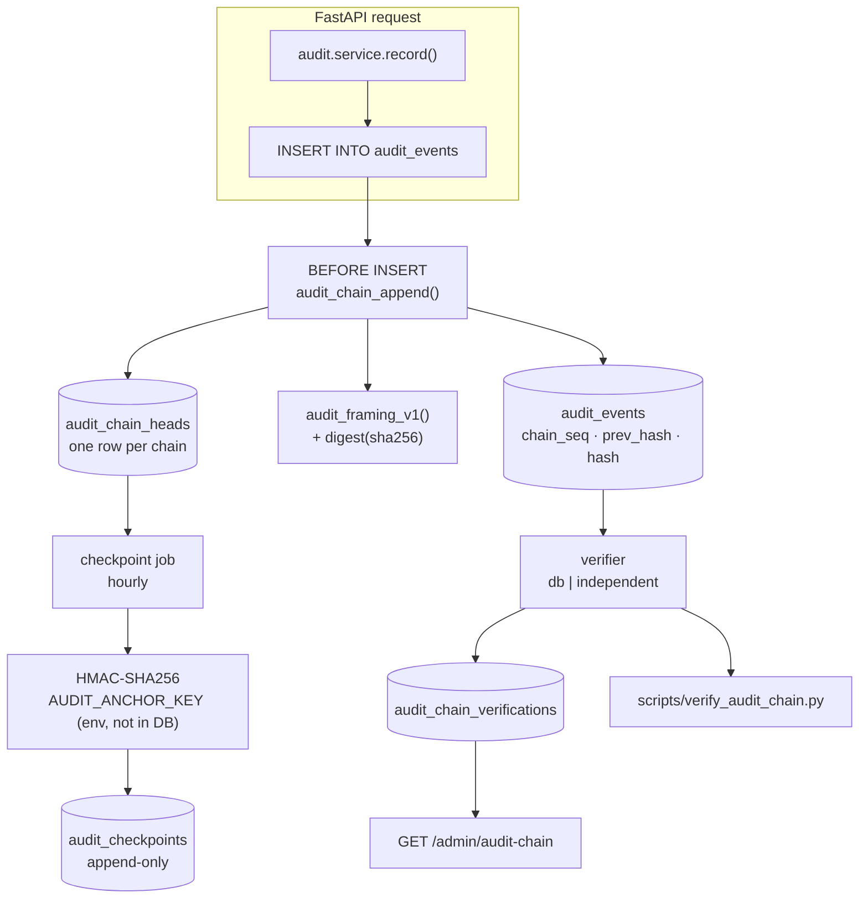

# CivicPulse — Tamper-Evident Audit Chain (A6.3)

**Implementation plan**

| | |
|---|---|
| Feature | Per-tenant SHA-256 hash chain over `audit_events`, signed checkpoints, and an independent verifier |
| Tracking ID | **A6.3** (`docs/team/person-a-backend.md`, Sprint 6) |
| Requirement | PRD §12.1 — "make audit events append-only **and tamper-evident**; restrict who can read or export them" |
| Type | **Code only** — no screens, no design tokens, no copy changes |
| Layer | Postgres schema + FastAPI admin API + Celery jobs + CLI |
| Estimate | **6 engineering days** (see §20) |
| Status | **Implemented** — see [ADR 0007](../adr/0007-audit-hash-chain.md) and the [recovery runbook](../runbooks/audit-chain-recovery.md) |
| Author's note | Written against `main` at migration head `0016`, `apps/api/openapi.json` current |

---

## 0. TL;DR

Today an audit row cannot be *changed* — a trigger raises on `UPDATE`, `DELETE` and `TRUNCATE`, and the
app role holds only `SELECT` and `INSERT`. But nothing detects a row that was changed **before** the
trigger existed, changed by a role that can disable it, or silently dropped by a restore from an older
backup. The current guarantee is "append-only if you trust the role and the trigger".

This feature makes the trail **self-verifying**: every row carries `chain_seq`, `prev_hash` and `hash`,
where `hash = SHA-256(canonical framing of the row ‖ prev_hash)`. One chain per tenant, and one separate
chain for platform-level (tenant-less) events. A daily and on-demand verifier walks a chain and reports
the **first** divergence with its `chain_seq`, and an hourly job seals the head into an
HMAC-signed checkpoint so that even a truncated tail is detectable.

Everything is server-side. There is no endpoint the web app must call, and no existing behaviour changes
except that every audited write now takes one extra row lock inside its own transaction (§7.4).

---

## 1. Why this feature

### 1.1 Evidence that it is genuinely missing

| Source | What it says |
|---|---|
| `docs/STATUS.md` → *Known gaps* | "**Audit:** not hash-chained yet (A6.3)." |
| `docs/team/person-a-backend.md` → Sprint 6 | "**A6.3 Audit hash chain:** each audit row stores the hash of the previous one, plus a verification command." |
| `docs/TEAM_PLAN.md` line 137 | Sprint A work item: "tamper-evident audit (hash chain)" |
| `docs/adr/0006-retention-and-anonymization.md` | Anonymization "stays until audit retention is decided **with the hash chain**" — A6.3 is a blocker for closing that decision |
| `apps/api/app/domains/audit/models.py` | Columns stop at `user_agent`; no `hash`, no `prev_hash`, no `seq` |

### 1.2 Why it fits "code only"

- It touches only `apps/api`: one domain module, two migrations, three ORM models, one Celery module, one
  CLI script, tests.
- No citizen or staff UI changes. The web app does not have to know the feature exists (the generated
  client picks up the new endpoints for free, and no page consumes them).
- It does not wait on any product-owner decision — unlike guest reporting (P6-05), SMS DLT (§STATUS
  decisions), or the analytics assistant (hosted LLM).
- It closes a *security* requirement rather than adding surface, so it cannot make the pilot harder.

### 1.3 Alternatives considered (and why they lost)

| Candidate | Verdict |
|---|---|
| Web Push / SMS provider adapters (P4 gap) | Blocked on the SMS provider decision + DLT registration. Web Push is already implemented (`app/domains/outbox/push.py`, `scripts/vapid_keys.py`) |
| Guest reporting (P6-05) | Explicitly awaiting a decision (1 Feb); needs CAPTCHA and a UI |
| Analytics assistant (P5 gap) | Needs a hosted-LLM decision (25 Jan); needs UI |
| Scheduled summary emails (P5 gap) | Code-only and attractive, but partially done (`outbox/email.py` exists) and lower risk-value than a security control |
| **Audit hash chain (A6.3)** | **Chosen**: unblocked, code-only, listed as a known gap, and a prerequisite for the retention decision |
| Hash the audit table into a single global chain | Rejected — breaks tenant isolation. A tenant-scoped verifier could not read past another tenant's row under RLS (§5.1) |
| Store the chain in a separate `audit_chain` table, one row per sealed batch | Rejected — doubles the write path and leaves individual rows unverifiable |

---

## 2. Scope

### 2.1 In scope

1. `chain_seq`, `prev_hash`, `hash` on every `audit_events` row, assigned by a `BEFORE INSERT` trigger.
2. One chain per tenant plus one platform chain (`tenant_id IS NULL`).
3. A single canonicalisation function, `audit_framing_v1(...)`, living in Postgres, reproducible
   byte-for-byte in Python.
4. Backfill of existing rows, verified, reversible.
5. HMAC-signed checkpoints (`audit_checkpoints`), created hourly while verification passes.
6. A verifier with two modes — `db` (one SQL statement) and `independent` (Python recomputes) — exposed
   as an async admin API, a Celery task, and a CLI with meaningful exit codes.
7. Structured signals: a status endpoint, log lines, an OTel counter, and an audit event for the act of
   verifying.
8. Housekeeping retention for verification runs.

### 2.2 Out of scope (explicitly)

| Not doing | Why / where it would go |
|---|---|
| External anchoring (S3 Object Lock, RFC 3161 timestamp, public ledger) | Phase 2 of this feature, behind `AUDIT_ANCHOR_SINK=none\|s3`. The interface is designed for it (§9.4) |
| Audit-log export (CSV/JSONL) | Separate PRD §12.1 item; the verifier's output shape already carries what an export needs |
| Key rotation automation | `key_id` is stored per checkpoint; rotating means adding a key with a new id (§9.3). Manual runbook step |
| Restricting *reads* further | Already `audit:read` only, admin role only, tenant-scoped by RLS |
| Notifying admins when a chain breaks | Wants a new `notifications.kind` value, which means altering two check constraints (§17.3) — deferred |
| Any web UI | This is a code-only feature by request; the endpoints are API/CLI-first |

---

## 3. Threat model and guarantees

### 3.1 Adversaries considered

| # | Adversary | Capability | Defeated by |
|---|---|---|---|
| A1 | A user of the app (any role) | Only the HTTP API | Existing RBAC + RLS; no new exposure |
| A2 | Someone with the **app role** credentials | `SELECT`/`INSERT` on `audit_events`, `UPDATE` on heads | Cannot `UPDATE`/`DELETE` audit rows (trigger + grants); cannot forge linkage without rewriting the whole tail *and* the heads row, and any tail truncation is caught by a signed checkpoint |
| A3 | Someone with **schema-owner** rights (a DBA, a leaked migration credential) | Can disable triggers, rewrite rows, rewrite heads, rewrite the SQL function | Detected by `independent` mode against a checkpoint signature whose key is **not in the database**; and by the external sink once implemented. Cannot be *prevented* — this is the honest limit |
| A4 | An attacker who restores an **older backup** or truncates the table | Deletes the newest rows | The head hash at checkpoint N (signed) can no longer be reached; the verifier reports a shortened chain against the last checkpoint |
| A5 | A buggy feature that writes audit rows by raw SQL | Bypasses `record()` | The trigger chains it anyway — a raw `INSERT` is still chained, so a bug cannot create an unchained row |

### 3.2 Guarantees (stated precisely)

- **G1 — Linkage.** For every tenant chain and for the platform chain, `chain_seq` is contiguous from 1
  with no gaps and no duplicates, and `prev_hash[n] = hash[n-1]` for all `n > 1`; `prev_hash[1]` is 32
  zero bytes.
- **G2 — Integrity.** `hash[n]` is the SHA-256 of the canonical framing of row `n` under version `v1`,
  including `prev_hash[n]`.
- **G3 — Atomicity.** A row and the head that points at it commit in the same transaction. A rolled-back
  action leaves neither a row nor a moved head, so no gap is ever produced by a failure.
- **G4 — Tail detection.** Given that at least one checkpoint exists at sequence `N`, a chain that has
  been truncated below `N` fails verification, and a chain whose head no longer matches the signed
  `head_hash` at `N` fails checkpoint verification.
- **G5 — Fail-closed.** If the chain cannot be extended, the audited write fails. There is no kill
  switch and no "unchained" mode (§7.5).
- **G6 — Non-repudiation of the verifier.** Every verification run is itself an audit event.

### 3.3 Non-guarantees

- Confidentiality: the hash is not a commitment that hides the payload. Rows are readable by
  `audit:read` exactly as today.
- Ordering by wall clock: `occurred_at` uses `now()` (transaction start) and is **not** the order of the
  chain. `chain_seq` is authoritative; `occurred_at` may be non-monotonic across rows (§6.4).
- Prevention of an A3 attacker. Detection only, and only once the independent verifier runs.

---

## 4. Architecture



### 4.1 Components

| Component | Path | Responsibility |
|---|---|---|
| Canonical framing + hashing | SQL function `audit_framing_v1`, `audit_hash_v1` (migration `0017`) | The **single** definition of what is hashed |
| Chain append | Trigger `audit_chain_append` (migration `0017`) | Assigns `chain_seq`, `prev_hash`, `hash`; serialises per chain |
| Python mirror | `apps/api/app/domains/audit/chain.py` | Reproduces the framing byte-for-byte; pure functions, unit-testable |
| Verifier engine | `apps/api/app/domains/audit/verification.py` | Range walking, gap detection, divergence reporting, both modes |
| Checkpoints | `apps/api/app/domains/audit/checkpoints.py` | Seal the head, HMAC-sign, verify signatures |
| Admin API | `apps/api/app/domains/audit/router.py` (second router) | Status, start/list/get verification, list checkpoints |
| Jobs | `apps/api/app/domains/audit/tasks.py` | `civicpulse.audit.checkpoint`, `civicpulse.audit.verify` |
| CLI | `apps/api/scripts/verify_audit_chain.py` | Operator-facing verification, including the platform chain |
| Models | `apps/api/app/domains/audit/models.py` | `AuditChainHead`, `AuditCheckpoint`, `AuditChainVerification` |

### 4.2 Where each concern lives (and why)

- **The framing lives in Postgres, not Python.** The trigger must chain rows even when the row was
  written by raw SQL (A5), so the definition has to be available at `INSERT` time. One implementation in
  SQL, one mirror in Python, kept honest by a golden fixture (§16.5).
- **The signature lives in Python.** The key must never enter the database, and the job already runs in
  Python (§9.3).
- **Verification is a domain module, not a router.** The CLI, the Celery task and the endpoint all call
  the same `verify_range()`.

---

## 5. Data model

Two migrations, matching repo convention (one concern each, both reversible):

- `apps/api/alembic/versions/0017_audit_hash_chain.py` — objects, columns nullable
- `apps/api/alembic/versions/0018_audit_chain_backfill.py` — backfill, then `SET NOT NULL`

Current head is `0016` (`down_revision = "0016"` for `0017`; **note** the graph is not numeric: `0013`
descends from `0015`, and `0016` descends from `0013` — verify with `alembic heads` before writing).

### 5.1 Chain scope: why `tenant_id` and not a global counter

`audit_events` is RLS-protected with `FORCE ROW LEVEL SECURITY` and the predicate used everywhere else:

```sql
tenant_id = nullif(current_setting('app.tenant_id', true), '')::uuid
OR current_setting('app.bypass_rls', true) = 'on'
```

A tenant-scoped verifier must be able to check **its own** chain without the bypass. Under RLS a tenant
can only see its own rows, so a chain spanning two tenants would have unreadable links and would also
leak the existence of another tenant's rows through gaps. Therefore:

| Scope | `tenant_id` | Verified by |
|---|---|---|
| Per tenant | the tenant's id | That tenant's municipal admin, the nightly job, the CLI |
| Platform | `NULL` | Platform admin via CLI only (never through a tenant-scoped endpoint) |

Platform rows match no tenant policy, so the existing `record()` already writes them inside
`rls_bypass(...)`. The head row for the platform chain is written inside that same block, which is why
the bypass ordering in `record()` must not change (§7.6).

### 5.2 `audit_events` — new columns

```python
# apps/api/app/domains/audit/models.py  (added to class AuditEvent)
chain_seq: Mapped[int] = mapped_column(BigInteger)                 # 1-based, per chain
prev_hash: Mapped[bytes] = mapped_column(LargeBinary(32))          # 32 zero bytes for seq 1
hash: Mapped[bytes] = mapped_column(LargeBinary(32))               # SHA-256, framing v1
```

Migration DDL:

```sql
ALTER TABLE audit_events
    ADD COLUMN chain_seq BIGINT,
    ADD COLUMN prev_hash BYTEA,
    ADD COLUMN hash BYTEA;

-- 0017 leaves them nullable; 0018 sets NOT NULL after the backfill.
ALTER TABLE audit_events
    ADD CONSTRAINT ck_audit_events_hash_len   CHECK (hash      IS NULL OR octet_length(hash)      = 32),
    ADD CONSTRAINT ck_audit_events_prev_len   CHECK (prev_hash IS NULL OR octet_length(prev_hash) = 32),
    ADD CONSTRAINT ck_audit_events_chain_seq  CHECK (chain_seq IS NULL OR chain_seq >= 1);
```

Uniqueness — Postgres treats `NULL`s as distinct in a plain `UNIQUE`, which would let the platform chain
carry duplicate sequences. Two partial unique indexes make the rule explicit and also *are* the index the
verifier scans in order:

```sql
CREATE UNIQUE INDEX uq_audit_events_chain_seq
    ON audit_events (tenant_id, chain_seq) WHERE tenant_id IS NOT NULL;
CREATE UNIQUE INDEX uq_audit_events_platform_chain_seq
    ON audit_events (chain_seq) WHERE tenant_id IS NULL;
```

`uq_audit_events_chain_seq` is a covering starting point for "walk this tenant's chain in order"; no extra
index is needed. (The existing `ix_audit_events_tenant_occurred` stays as it is — it serves the current
list endpoint, not the chain.)

### 5.3 `audit_chain_heads`

The mutable cursor of each chain. One row per tenant plus one platform row. It is deliberately the only
mutable table in the feature, and it holds no payload — only where the chain ends.

```sql
CREATE TABLE audit_chain_heads (
    tenant_id   UUID,
    next_seq    BIGINT      NOT NULL,   -- the sequence the next event will take
    last_hash   BYTEA       NOT NULL,   -- hash of the last event; 32 zero bytes at genesis
    updated_at  TIMESTAMPTZ NOT NULL DEFAULT clock_timestamp(),

    CONSTRAINT pk_audit_chain_heads PRIMARY KEY (tenant_id),   -- see note below
    CONSTRAINT fk_audit_chain_heads_tenant_id_tenants
        FOREIGN KEY (tenant_id) REFERENCES tenants (id) ON DELETE RESTRICT,
    CONSTRAINT uq_audit_chain_heads_tenant UNIQUE NULLS NOT DISTINCT (tenant_id),
    CONSTRAINT ck_audit_chain_heads_next_seq CHECK (next_seq >= 1),
    CONSTRAINT ck_audit_chain_heads_last_hash_len CHECK (octet_length(last_hash) = 32)
);
```

Two notes that cost an afternoon if missed:

1. A primary key cannot be `NULL`, so `PRIMARY KEY (tenant_id)` is **wrong** for the platform row. Use a
   synthetic key instead — `id UUID PRIMARY KEY DEFAULT gen_random_uuid()` — and keep
   `UNIQUE NULLS NOT DISTINCT (tenant_id)` as the natural key. Postgres 16 supports it (the repo already
   uses `postgresql_nulls_not_distinct=True` in `0001`, `tenants.slug`).
2. With `NULLS NOT DISTINCT`, `ON CONFLICT ON CONSTRAINT uq_audit_chain_heads_tenant DO NOTHING` is
   unambiguous and works for the `NULL` row; index inference from a bare column list is fussier. Use the
   constraint form.

RLS + grants:

```sql
ALTER TABLE audit_chain_heads ENABLE ROW LEVEL SECURITY;
ALTER TABLE audit_chain_heads FORCE ROW LEVEL SECURITY;
CREATE POLICY tenant_isolation ON audit_chain_heads
    USING (tenant_id = nullif(current_setting('app.tenant_id', true), '')::uuid
           OR current_setting('app.bypass_rls', true) = 'on')
    WITH CHECK (tenant_id = nullif(current_setting('app.tenant_id', true), '')::uuid
           OR current_setting('app.bypass_rls', true) = 'on');

GRANT SELECT, INSERT, UPDATE ON audit_chain_heads TO civicpulse_app;
-- no DELETE: a head is never removed
```

`UPDATE` is required because the trigger writes the head **as the invoking role** — the function must be
`SECURITY INVOKER` (the default). Do **not** mark it `SECURITY DEFINER`: it would run as the table owner,
and `FORCE ROW LEVEL SECURITY` would then hide the platform row from it (§7.6).

### 5.4 `audit_checkpoints` (append-only)

```sql
CREATE TABLE audit_checkpoints (
    id          UUID        PRIMARY KEY DEFAULT gen_random_uuid(),
    tenant_id   UUID        REFERENCES tenants (id) ON DELETE RESTRICT,   -- NULL = platform chain
    up_to_seq   BIGINT      NOT NULL,
    head_hash   BYTEA       NOT NULL,
    key_id      TEXT        NOT NULL,                 -- which anchor key signed it
    signature   BYTEA       NOT NULL,                 -- HMAC-SHA256, 32 bytes
    created_at  TIMESTAMPTZ NOT NULL DEFAULT clock_timestamp(),

    CONSTRAINT uq_audit_checkpoints_scope_seq UNIQUE NULLS NOT DISTINCT (tenant_id, up_to_seq),
    CONSTRAINT ck_audit_checkpoints_up_to_seq CHECK (up_to_seq >= 1),
    CONSTRAINT ck_audit_checkpoints_head_hash_len CHECK (octet_length(head_hash) = 32),
    CONSTRAINT ck_audit_checkpoints_signature_len CHECK (octet_length(signature) = 32)
);

CREATE INDEX ix_audit_checkpoints_tenant_created
    ON audit_checkpoints (tenant_id, created_at DESC);
```

Append-only enforcement reuses the pattern from `0001` with a generic message:

```sql
CREATE FUNCTION audit_checkpoints_reject_change() RETURNS trigger
LANGUAGE plpgsql AS $$
BEGIN
    RAISE EXCEPTION '% is append-only: % is not allowed', TG_TABLE_NAME, TG_OP
        USING ERRCODE = 'insufficient_privilege';
END;
$$;

CREATE TRIGGER audit_checkpoints_no_update_delete
    BEFORE UPDATE OR DELETE ON audit_checkpoints
    FOR EACH ROW EXECUTE FUNCTION audit_checkpoints_reject_change();
CREATE TRIGGER audit_checkpoints_no_truncate
    BEFORE TRUNCATE ON audit_checkpoints
    FOR EACH STATEMENT EXECUTE FUNCTION audit_checkpoints_reject_change();

GRANT SELECT, INSERT ON audit_checkpoints TO civicpulse_app;
```

### 5.5 `audit_chain_verifications`

```sql
CREATE TABLE audit_chain_verifications (
    id              UUID        PRIMARY KEY DEFAULT gen_random_uuid(),
    tenant_id       UUID        NOT NULL
                    REFERENCES tenants (id) ON DELETE CASCADE,
    from_seq        BIGINT      NOT NULL,
    to_seq          BIGINT      NOT NULL,
    mode            TEXT        NOT NULL,   -- 'db' | 'independent'
    status          TEXT        NOT NULL,   -- 'pending' | 'running' | 'passed' | 'failed' | 'error'
    checked_count   BIGINT      NOT NULL DEFAULT 0,
    first_bad_seq   BIGINT,
    failure_reason  TEXT        CONSTRAINT ck_audit_chain_verifications_reason
                    CHECK (failure_reason IS NULL OR length(failure_reason) <= 300),
    requested_by    UUID,                   -- no FK: the record outlives the user
    started_at      TIMESTAMPTZ NOT NULL DEFAULT clock_timestamp(),
    finished_at     TIMESTAMPTZ,

    CONSTRAINT ck_audit_chain_verifications_mode
        CHECK (mode IN ('db', 'independent')),
    CONSTRAINT ck_audit_chain_verifications_status
        CHECK (status IN ('pending', 'running', 'passed', 'failed', 'error')),
    CONSTRAINT ck_audit_chain_verifications_range CHECK (from_seq >= 1 AND to_seq >= from_seq)
);

CREATE INDEX ix_audit_chain_verifications_tenant_started
    ON audit_chain_verifications (tenant_id, started_at DESC);

-- One run in flight per tenant, enforced by the database rather than by a check-then-insert.
CREATE UNIQUE INDEX uq_audit_chain_verifications_in_flight
    ON audit_chain_verifications (tenant_id)
    WHERE status IN ('pending', 'running');
```

That partial unique index is the concurrency control for `POST …/verifications`: two simultaneous
requests cannot both insert a `pending` row. The second gets a `Conflict` (409) from the unique violation,
which the service translates — no Redis lock, no race.

RLS + grants `SELECT, INSERT, UPDATE, DELETE` (the worker updates; housekeeping deletes).

### 5.6 ORM models

Add to `apps/api/app/domains/audit/models.py`:

```python
class AuditChainHead(Base):
    __tablename__ = "audit_chain_heads"

    id: Mapped[uuid.UUID] = mapped_column(primary_key=True, server_default=func.gen_random_uuid())
    tenant_id: Mapped[uuid.UUID | None] = mapped_column(ForeignKey("tenants.id", ondelete="RESTRICT"))
    next_seq: Mapped[int] = mapped_column(BigInteger)
    last_hash: Mapped[bytes] = mapped_column(LargeBinary(32))
    updated_at: Mapped[datetime] = mapped_column(DateTime(timezone=True), server_default=func.clock_timestamp())


class AuditCheckpoint(Base): ...      # mirrors §5.4
class AuditChainVerification(Base): ...  # mirrors §5.5
```

Register all three in `apps/api/app/models.py` (both the imports and `__all__`) — `tests/test_schema.py`
builds the Alembic diff from `app.models.Base`, so an unregistered model is a **silent** escape from the
drift check, and a registered-but-unmigrated one is a red test.

---

## 6. Canonical framing, version 1

This is the part that must be exactly right, because a one-byte disagreement between SQL and Python makes
every chain unverifiable.

### 6.1 Requirements

- **Injective**: two different row sets must never produce the same byte string.
- **Deterministic**: no session settings, locale, or `TimeZone` may affect the bytes.
- **Reproducible outside Postgres**, so an operator can verify without trusting a database function.
- **Versioned**: a future change must not invalidate existing rows.

### 6.2 The encoding

Fixed field order, every field length-prefixed so no separator can be smuggled into a value:

```
civicpulse.audit.v1|prev:<64 hex>|tenant:<f>|seq:<f>|occurred_at_us:<f>|actor:<f>
|action:<f>|entity_type:<f>|entity_id:<f>|before:<f>|after:<f>|request_id:<f>
|ip:<f>|user_agent:<f>
```

where a field `<f>` is either
- `~` for SQL `NULL`, or
- `N:<utf8 bytes>` — `N` is the **octet** length of the value, decimal, with no leading zeros.

Rules:

| Field | Encoding |
|---|---|
| `prev` | lowercase hex of the 32-byte `prev_hash` (always present) |
| `tenant` | `~` for platform events, else the canonical lowercase UUID |
| `seq` | decimal, no padding |
| `occurred_at_us` | `(extract(epoch from occurred_at) * 1000000)::bigint` — microseconds since the Unix epoch, **not** ISO text |
| `actor` | `~` or lowercase UUID |
| `action`, `entity_type`, `entity_id` | the column value as UTF-8 |
| `before`, `after` | the column's **jsonb text rendering**, as returned by `before::text` |
| `request_id`, `ip`, `user_agent` | the column value as UTF-8 |

Then:

```
hash = SHA-256( UTF8( framing ) )
```

Why these choices:

- `occurred_at_us` as an integer, not ISO 8601, because `to_jsonb(timestamptz)` and `to_char` both depend
  on the `TimeZone`/`DateStyle` GUC or are only `STABLE`. Microseconds are exact for `timestamptz`, and
  Python reproduces them exactly with `(dt - EPOCH) // timedelta(microseconds=1)`.
- Length prefixes rather than `|`-joins alone, because `action` and `before` are free text and could
  otherwise be shifted across a field boundary (`action='a|b'` vs `action='a', ip='b'`).
- `before::text` (jsonb rendering) rather than re-serialising in Python: jsonb normalises key order and
  duplicate keys at storage time, so the rendering is stable for a given value, and any change to the
  value changes the rendering. The independent verifier still does not have to *emulate* jsonb: it hashes
  the bytes Postgres renders. That is a dependency on Postgres's jsonb text format, pinned by the golden
  fixture (§16.5), not on any function we wrote.
- The `civicpulse.audit.v1` prefix is the domain tag and the version. A `v2` would be a new pair of
  functions and a new value in a `hash_version` column (§6.5).

### 6.3 SQL implementation (migration `0017`)

```sql
CREATE FUNCTION audit_frame_field(p_value text) RETURNS text
LANGUAGE sql IMMUTABLE STRICT AS $$
    SELECT octet_length(p_value)::text || ':' || p_value
$$;
```

```sql
CREATE FUNCTION audit_framing_v1(
    p_prev        bytea,
    p_tenant      uuid,
    p_seq         bigint,
    p_occurred    timestamptz,
    p_actor       uuid,
    p_action      text,
    p_entity_type text,
    p_entity_id   text,
    p_before      jsonb,
    p_after       jsonb,
    p_request_id  text,
    p_ip          text,
    p_user_agent  text
) RETURNS text
LANGUAGE sql STABLE AS $$
    SELECT 'civicpulse.audit.v1'
        || '|prev:'        || encode(p_prev, 'hex')
        || '|tenant:'      || coalesce(p_tenant::text, '~')
        || '|seq:'         || p_seq::text
        || '|occurred_at_us:' || ((extract(epoch FROM p_occurred) * 1000000)::bigint)::text
        || '|actor:'       || coalesce(p_actor::text, '~')
        || '|action:'      || audit_frame_field(p_action)
        || '|entity_type:' || audit_frame_field(p_entity_type)
        || '|entity_id:'   || coalesce(audit_frame_field(p_entity_id), '~')
        || '|before:'      || coalesce(audit_frame_field(p_before::text), '~')
        || '|after:'       || coalesce(audit_frame_field(p_after::text), '~')
        || '|request_id:'  || coalesce(audit_frame_field(p_request_id), '~')
        || '|ip:'          || coalesce(audit_frame_field(p_ip), '~')
        || '|user_agent:'  || coalesce(audit_frame_field(p_user_agent), '~')
$$;
```

**`STABLE`, not `IMMUTABLE`.** `jsonb→text` and `extract(epoch …)` are stable at worst; declaring the
function `IMMUTABLE` would be a lie that Postgres does not check, and it is not used in any index, so
`STABLE` is both honest and sufficient. (`audit_frame_field` *is* genuinely `IMMUTABLE` and is marked so.)

`audit_frame_field` is `STRICT`, so `coalesce(...)` outside it supplies the `~`; that is why every
optional field reads `coalesce(audit_frame_field(x), '~')` and not `audit_frame_field(coalesce(x,'~'))`
(the latter would encode the literal `~` with a length, which is still injective but noisier — pick one
and keep the Python mirror in step).

```sql
CREATE FUNCTION audit_hash_v1(... same arguments ...) RETURNS bytea
LANGUAGE sql STABLE AS $$
    SELECT digest(convert_to(audit_framing_v1($1, $2, $3, $4, $5, $6, $7, $8, $9, $10, $11, $12, $13),
                              'UTF8'),
                  'sha256')
$$;
```

`digest` and `gen_random_uuid` come from `pgcrypto`, which `tests/test_schema.py` already asserts is
installed.

### 6.4 The Python mirror

```python
# apps/api/app/domains/audit/chain.py
"""The canonical framing and hashing of an audit row (mirror of audit_framing_v1)."""

from __future__ import annotations

import hashlib
from datetime import datetime, timedelta, timezone
from typing import Any, Mapping

DOMAIN_TAG = "civicpulse.audit.v1"
HASH_SIZE = 32
GENESIS_HASH = b"\x00" * HASH_SIZE
_EPOCH = datetime(1970, 1, 1, tzinfo=timezone.utc)
_ONE_MICROSECOND = timedelta(microseconds=1)


def micros(moment: datetime) -> int:
    """Microseconds since the Unix epoch, exactly, without float rounding.

    `int(moment.timestamp() * 1_000_000)` is wrong: `timestamp()` returns a float and loses the
    low digits for dates far from the epoch. Integer division of a timedelta is exact.
    """
    return (moment.astimezone(timezone.utc) - _EPOCH) // _ONE_MICROSECOND


def _field(value: str | None) -> str:
    if value is None:
        return "~"
    return f"{len(value.encode('utf-8'))}:{value}"


def framing(row: Mapping[str, Any]) -> bytes:
    """`row` carries the columns as the database renders them (`before_text`, …)."""
    parts = [
        DOMAIN_TAG,
        "prev:" + bytes(row["prev_hash"]).hex(),
        "tenant:" + (str(row["tenant_id"]) if row["tenant_id"] else "~"),
        f"seq:{row['chain_seq']}",
        f"occurred_at_us:{micros(row['occurred_at'])}",
        "actor:" + (str(row["actor_id"]) if row["actor_id"] else "~"),
        "action:" + _field(row["action"]),
        "entity_type:" + _field(row["entity_type"]),
        "entity_id:" + _field(row["entity_id"]),
        "before:" + _field(row["before_text"]),     # before::text from Postgres
        "after:" + _field(row["after_text"]),
        "request_id:" + _field(row["request_id"]),
        "ip:" + _field(row["ip"]),
        "user_agent:" + _field(row["user_agent"]),
    ]
    return "|".join(parts).encode("utf-8")


def hash_row(row: Mapping[str, Any]) -> bytes:
    return hashlib.sha256(framing(row)).digest()


def hex_hash(value: bytes) -> str:
    """The form every API response and CLI line uses."""
    return value.hex()
```

The mirror must be a literal transcription of the SQL — no cleverness, no shared helper that could drift
from `audit_frame_field`, and one test that compares the two byte for byte (§16.3).

Non-monotonic `occurred_at` (G-note §3.3): `now()` is transaction start, so two rows in one transaction
carry the same instant, and a row from a longer transaction can be chained after a row from a shorter one
that started later. That is fine — `chain_seq` is the order. Do **not** "fix" this by sorting on
`occurred_at`; the chain would stop verifying.

### 6.5 Versioning

- The version is inside the framing, so a `v1` row can never be confused with a `v2` row.
- If a second version is ever needed, add `hash_version SMALLINT NOT NULL DEFAULT 1` to `audit_events`
  and branch in the verifier. **Do not** rewrite existing hashes.
- The golden fixture (§16.5) is what catches an accidental change to `v1` in either implementation.

---

## 7. The append path

### 7.1 Trigger

```sql
CREATE FUNCTION audit_chain_append() RETURNS trigger
LANGUAGE plpgsql AS $fn$
DECLARE
    v_seq  bigint;
    v_prev bytea;
BEGIN
    IF NEW.chain_seq IS NOT NULL OR NEW.prev_hash IS NOT NULL OR NEW.hash IS NOT NULL THEN
        RAISE EXCEPTION 'audit_events rows are chained by the database; do not supply chain columns'
            USING ERRCODE = 'insufficient_privilege';
    END IF;

    INSERT INTO audit_chain_heads (tenant_id, next_seq, last_hash)
    VALUES (NEW.tenant_id, 1, decode(repeat('00', 32), 'hex'))
    ON CONFLICT ON CONSTRAINT uq_audit_chain_heads_tenant DO NOTHING;

    UPDATE audit_chain_heads
       SET next_seq = next_seq + 1
     WHERE tenant_id IS NOT DISTINCT FROM NEW.tenant_id
    RETURNING next_seq - 1, last_hash INTO v_seq, v_prev;

    NEW.chain_seq := v_seq;
    NEW.prev_hash := v_prev;
    NEW.hash := audit_hash_v1(v_prev, NEW.tenant_id, v_seq, NEW.occurred_at, NEW.actor_id,
                              NEW.action, NEW.entity_type, NEW.entity_id,
                              NEW.before, NEW.after, NEW.request_id, NEW.ip, NEW.user_agent);

    UPDATE audit_chain_heads
       SET last_hash = NEW.hash, updated_at = clock_timestamp()
     WHERE tenant_id IS NOT DISTINCT FROM NEW.tenant_id;

    RETURN NEW;
END
$fn$;

CREATE TRIGGER audit_chain_assign
    BEFORE INSERT ON audit_events
    FOR EACH ROW EXECUTE FUNCTION audit_chain_append();
```

Also add a `AFTER INSERT ON tenants` trigger to pre-create the head row, so a freshly provisioned tenant
shows a head of `next_seq = 1` in the status endpoint before its first audited action:

```sql
CREATE FUNCTION audit_chain_seed_tenant() RETURNS trigger LANGUAGE plpgsql AS $fn$
BEGIN
    INSERT INTO audit_chain_heads (tenant_id, next_seq, last_hash)
    VALUES (NEW.id, 1, decode(repeat('00', 32), 'hex'))
    ON CONFLICT ON CONSTRAINT uq_audit_chain_heads_tenant DO NOTHING;
    RETURN NULL;
END
$fn$;
CREATE TRIGGER audit_chain_seed_tenant AFTER INSERT ON tenants
    FOR EACH ROW EXECUTE FUNCTION audit_chain_seed_tenant();
```

The platform head row is created by the migration itself:

```sql
INSERT INTO audit_chain_heads (tenant_id, next_seq, last_hash)
VALUES (NULL, 1, decode(repeat('00', 32), 'hex'))
ON CONFLICT ON CONSTRAINT uq_audit_chain_heads_tenant DO NOTHING;
```

### 7.2 Why the head row is the lock

The `UPDATE audit_chain_heads … RETURNING` in the trigger takes a **row-level lock** on that chain's head
and holds it until the surrounding transaction commits or rolls back. Consequences:

- Two concurrent audited actions in the same tenant serialise on that row, so `chain_seq` is contiguous
  by construction — no advisory lock, no retry loop, no `SELECT max(chain_seq)` race.
- The lock is scoped per tenant, so a busy tenant's audited writes do not block another tenant's.
- The lock is released by the same rollback that removes the row, which is exactly what G3 requires.

The alternative (read `max(chain_seq)` and retry on a unique violation) was rejected: it turns a
correctness property into a retry budget, and a burst of logins in one tenant would produce visible
contention instead of a short queue.

### 7.3 Cost

Per audited write, the trigger adds: one `INSERT … ON CONFLICT DO NOTHING` (a no-op after the first
event), two single-row `UPDATE`s on a table of one row per tenant, and one SHA-256 over roughly 0.5–2 KB.
Measured budget (§21, AC-7): **≤ 2 ms p95 added** to the enclosing transaction, and **no more than one
extra round-trip** visible to the caller, because it all happens inside the existing `INSERT` statement.

### 7.4 Tuning and contention

`audit_events` receives a small fraction of writes: logins, registrations, admin changes, status moves,
exports. Even a 500 reports/minute tenant produces far fewer audited rows. If a specific tenant ever
contends visibly:

1. Confirm with `pg_stat_activity.wait_event = 'transactionid'` filtered to `audit_chain_heads`.
2. Then consider the documented escape hatch: a `chain_partition` column (e.g. per day) with the verifier
   walking partitions in order. **Not built now** — it changes the framing and deserves its own ADR.

### 7.5 Fail-closed, deliberately

There is no `AUDIT_CHAIN_ENABLED` flag. If the head row is missing, the check constraint fails, or the
framing function errors, the audited action fails with a 500 and the transaction rolls back. The
reasoning: an unchained row is an audit hole that no later verification can distinguish from an attack.
An operator with an outage has the trigger `DISABLE`d only as a declared incident with a runbook entry
(`docs/runbooks/audit-chain-recovery.md`), and the unbroken period is detectable afterwards because the
chain resumes with a `prev_hash` that does not match.

Mitigations that make fail-closed tolerable:

- The head row is created by a `tenants` trigger *and* by `ON CONFLICT DO NOTHING` in the append, so "no
  head row" cannot happen on a live tenant.
- `tests/test_smoke`-style coverage: every existing audited path in the suite exercises the trigger.
- A `GET /admin/audit-chain` status check an operator can hit before a deploy (§11.2).

### 7.6 Hazard: the platform bypass ordering in `record()`

`record()` currently does:

```python
if tenant_id is None:
    async with rls_bypass(db, reason="platform audit event"):
        db.add(event)
        await db.flush()          # <-- the INSERT, and therefore the trigger, runs inside the bypass
else:
    db.add(event)
    await db.flush()
```

The trigger's `INSERT`/`UPDATE` on `audit_chain_heads` executes at that `flush`. For platform events the
head row has `tenant_id IS NULL`, which matches no tenant policy, so it is reachable only while
`app.bypass_rls = 'on'`. **The `flush()` must stay inside the `rls_bypass` block.** Add a comment to
`record()` saying so, and a regression test (`test_platform_chain_appends_under_bypass`) that fails with
`new row violates row-level security policy` if someone moves it.

A second, subtler hazard: `record()` is often called mid-transaction. If a caller flushes, then rolls
back a savepoint, the head `UPDATE` is rolled back too — correct. But if a caller uses `begin_nested` and
only rolls back the inner savepoint, the head lock is released while the outer transaction continues;
the next append then takes the lock again and assigns the same `chain_seq`, which is fine because the
first insert was rolled back. No action needed — but do not "optimise" by caching the head in Python.

---

## 8. Backfilling existing rows

Existing deployments (and the seeded demo) have audit rows with no chain columns. `0018` fills them.

### 8.1 Constraint: the append-only trigger blocks `UPDATE`

`audit_events_no_update_delete` raises on any `UPDATE`. The backfill therefore has to disable that
trigger — for one transaction, as the migration owner:

```sql
ALTER TABLE audit_events DISABLE TRIGGER audit_events_no_update_delete;
-- … backfill …
ALTER TABLE audit_events ENABLE TRIGGER audit_events_no_update_delete;
```

`ALTER TABLE … DISABLE TRIGGER` requires owner rights, which the Alembic connection has
(`MIGRATION_DATABASE_URL`). It is also why this must be a **migration**, not something the API can do: no
role that serves traffic may ever disable it. Write the reason in a comment at the top of `0018`.

Also disable `audit_chain_assign` during the backfill, because the backfill supplies the chain columns
and the trigger explicitly refuses pre-filled ones (§7.1):

```sql
ALTER TABLE audit_events DISABLE TRIGGER audit_chain_assign;
```

### 8.2 The backfill query

Chained hashing cannot be done with `lag(hash) OVER (…)` — the hash of row *n* contains the hash of row
*n−1*, so each value depends on the previously *computed* value, not a stored one. Use a `WITH RECURSIVE`
walk per chain:

```sql
WITH RECURSIVE ordered AS (
    SELECT id, tenant_id,
           row_number() OVER (PARTITION BY tenant_id ORDER BY id) AS seq
      FROM audit_events
     WHERE hash IS NULL
), walk AS (
    -- genesis of every chain: the head row's last_hash, or 32 zero bytes when the chain is empty
    SELECT o.id,
           o.tenant_id,
           o.seq,
           coalesce(h.last_hash, decode(repeat('00', 32), 'hex')) AS prev_hash
      FROM ordered o
      LEFT JOIN audit_chain_heads h ON h.tenant_id IS NOT DISTINCT FROM o.tenant_id
     WHERE o.seq = 1
    UNION ALL
    SELECT n.id,
           n.tenant_id,
           n.seq,
           audit_hash_v1(w.prev_hash, e.tenant_id, w.seq, e.occurred_at, e.actor_id,
                         e.action, e.entity_type, e.entity_id, e.before, e.after,
                         e.request_id, e.ip, e.user_agent)
      FROM walk w
      JOIN ordered n ON n.tenant_id IS NOT DISTINCT FROM w.tenant_id AND n.seq = w.seq + 1
      JOIN audit_events e ON e.id = n.id
)
UPDATE audit_events t
   SET chain_seq = w.seq,
       prev_hash = w.prev_hash,
       hash = audit_hash_v1(w.prev_hash, t.tenant_id, w.seq, t.occurred_at, t.actor_id,
                            t.action, t.entity_type, t.entity_id, t.before, t.after,
                            t.request_id, t.ip, t.user_agent)
  FROM walk w
 WHERE t.id = w.id;
```

Then advance every head to the new tail:

```sql
UPDATE audit_chain_heads h
   SET next_seq = coalesce(tail.max_seq, 0) + 1,
       last_hash = coalesce(tail.last_hash, h.last_hash),
       updated_at = clock_timestamp()
  FROM (SELECT tenant_id, max(chain_seq) AS max_seq,
               (array_agg(hash ORDER BY chain_seq DESC))[1] AS last_hash
          FROM audit_events GROUP BY tenant_id) tail
 WHERE h.tenant_id IS NOT DISTINCT FROM tail.tenant_id;
```

### 8.3 Guardrails in `0018`

| Guard | Behaviour |
|---|---|
| Row count | `SELECT count(*) FROM audit_events WHERE hash IS NULL`. If `> 2_000_000`, raise with a message pointing at `scripts/verify_audit_chain.py --backfill` (a future streaming variant), rather than holding a long lock |
| Idempotency | `WHERE hash IS NULL` throughout, so a re-run after a partial failure is safe (and the migration is transactional anyway) |
| Verification | The last statement of `0018` re-runs the `db`-mode check over every chain and raises if any chain does not verify — a migration that corrupts the chain is not allowed to commit |
| `NOT NULL` | Only after the backfill and the self-check: `ALTER TABLE audit_events ALTER COLUMN chain_seq SET NOT NULL` (×3) |
| Downgrade | `0018.downgrade()` drops the three `NOT NULL`s only. It must **not** clear the columns: rollback of `0017` drops them, and a chain that has been partly built is still evidence |

### 8.4 Verification after the backfill

Run, on a restored copy of production first:

```sh
cd apps/api
uv run python -m scripts.verify_audit_chain --all-tenants --mode independent
```

Expected: `passed` for every chain, `checked` equal to the pre-migration row count, exit code `0`.

---

## 9. Checkpoints (sealing the head)

### 9.1 Why

The chain alone cannot detect **truncation**: delete the last 50 rows and the remaining prefix still
verifies perfectly. A checkpoint records "the head at this moment was `H` at sequence `N`", signed with a
key that is not in the database, so removing rows below `N` becomes visible.

### 9.2 Algorithm (hourly job)

```
for each chain where head.next_seq - 1 > last_checkpoint.up_to_seq:      # tenant chains + platform
    last_sealed = last_checkpoint.up_to_seq or 0
    report = verify_range(chain, from_seq=last_sealed + 1, to_seq=head.seq, mode="db")
    if report.failed:
        log(ERROR, "audit chain failed before sealing")   # do not seal a broken chain
        continue
    message = "civicpulse.audit.checkpoint.v1|" + scope + "|" + seq + "|" + head_hash.hex()
              + "|" + micros(created_at)
    signature = HMAC-SHA256(audit_anchor_key, message)
    INSERT INTO audit_checkpoints (tenant_id, up_to_seq, head_hash, key_id, signature)
```

Properties:

- `up_to_seq` is the head sequence **at seal time**, and `head_hash` is the head hash at that sequence —
  read from `audit_chain_heads` in the same statement, so they cannot disagree.
- Sealing only happens after the range since the previous checkpoint verified. A broken chain stops being
  sealed, which freezes the evidence at the last good state.
- The unique `(tenant_id, up_to_seq)` makes a double seal a no-op (`ON CONFLICT DO NOTHING`), so an
  overlapping or retried job is harmless.
- Nothing is sealed when the head has not moved — no checkpoint spam for an idle tenant.

### 9.3 Signing key

```python
# app/core/config.py
audit_anchor_key: SecretStr | None = None      # required in production
audit_anchor_key_id: str = "k1"
```

Add `audit_anchor_key` to the production check in `Settings._check_production` (the loop that currently
validates `jwt_secret` and `otp_hmac_secret`), with a 32-character minimum, and make the checkpoint job
raise `ServiceUnavailable` at start-up if the key is missing in production — the same posture as
`vapid_private_key` (the push channel says "unavailable" rather than silently skipping).

Why HMAC and not an asymmetric signature: an HMAC key held in the app's environment is enough to defeat
A2 (app-role credentials) and A4 (backup rollback) — the attacker with DB write access cannot compute a
valid signature without the key. A3 (owner/superuser) can also read the app's environment in the limit,
which is exactly the case that wants the external sink (§9.4) or an asymmetric key with the private half
in an HSM. Documented, not over-engineered for a municipal pilot.

Rotation: `key_id` stores which key signed each checkpoint. Rotation = add `AUDIT_ANCHOR_KEY_ID=k2` and
`AUDIT_ANCHOR_KEY`, keeping `k1` in a `AUDIT_ANCHOR_KEYS_OLD` map for verification of older checkpoints.
Verification looks up by `key_id`. Since this is manual and rare, the old keys live in settings, not in a
table.

### 9.4 The external sink (Phase 2, designed now, not built)

```python
class AnchorSink(Protocol):
    async def publish(self, checkpoint: AuditCheckpoint) -> None: ...
```

Implementations: `none` (default), `file` (an append-only file path, for air-gapped deployments), `s3`
(a JSON object per checkpoint in a bucket with Object Lock — `app/core/storage.py` already has a boto3
client and bucket handling). The sink receives the same signed body, so verification can compare
`head_hash` against the last *published* checkpoint, not merely the last row in the database.

Shipping this in the same PR is tempting; it is deliberately separate because it adds deployment
configuration (a bucket policy, a lock retention period) that no test can prove.

---

## 10. The verification engine

`apps/api/app/domains/audit/verification.py` is the single implementation used by the endpoint, the
Celery task and the CLI.

### 10.1 Interface

```python
@dataclass(frozen=True, slots=True)
class Divergence:
    chain_seq: int
    reason: Literal["gap", "link", "hash", "range", "empty"]
    detail: str


@dataclass(frozen=True, slots=True)
class ChainReport:
    tenant_id: uuid.UUID | None
    from_seq: int
    to_seq: int
    mode: Literal["db", "independent"]
    checked: int
    divergence: Divergence | None
    head_seq: int
    head_hash: bytes

    @property
    def passed(self) -> bool: ...


async def verify_range(
    db: AsyncSession,
    *,
    tenant_id: uuid.UUID | None,
    from_seq: int,
    to_seq: int,
    mode: Mode = "db",
    batch_size: int = 5_000,
) -> ChainReport: ...
```

### 10.2 Range semantics

`from_seq`/`to_seq` are inclusive and are treated as a **window of the chain**, not a standalone chain:

- If `from_seq == 1`, the first row's `prev_hash` must be 32 zero bytes.
- If `from_seq > 1`, the engine first reads the hash at `from_seq - 1` and requires
  `prev_hash(from_seq) == hash(from_seq - 1)`. That row is outside the window and is not counted.
- `to_seq` must not exceed the head sequence at the moment verification started; clamping silently would
  make a "passed" report describe a different range than the caller asked for. Clamp **and report** the
  effective `to_seq` in the result.

### 10.3 `db` mode — one statement

```sql
WITH rows AS (
    SELECT e.chain_seq, e.prev_hash, e.hash,
           lag(e.hash) OVER (PARTITION BY e.tenant_id ORDER BY e.chain_seq) AS prior_hash,
           audit_hash_v1(e.prev_hash, e.tenant_id, e.chain_seq, e.occurred_at, e.actor_id,
                         e.action, e.entity_type, e.entity_id, e.before, e.after,
                         e.request_id, e.ip, e.user_agent) AS expected_hash
      FROM audit_events e
     WHERE e.chain_seq BETWEEN :lo AND :hi
       AND e.tenant_id IS NOT DISTINCT FROM :tenant
)
SELECT chain_seq, prev_hash, hash, prior_hash, expected_hash
  FROM rows
 WHERE (prior_hash IS NOT NULL AND prev_hash <> prior_hash)
    OR hash <> expected_hash
 ORDER BY chain_seq
 LIMIT 50;
```

Batched by `chain_seq` ranges (`hi - lo < batch_size`) so memory stays flat and the scan uses
`uq_audit_events_chain_seq`. Gap detection for the batch:
`SELECT count(*) AS n, min(chain_seq), max(chain_seq) FROM … WHERE chain_seq BETWEEN lo AND hi` — if
`max - min + 1 <> n`, the missing sequence is the first gap; find it with
`generate_series(min, max) EXCEPT SELECT chain_seq`.

Cost: one index scan plus one SHA-256 per row, all in the database. This is the fast path: ~100k
rows/second on a pilot-sized Postgres.

### 10.4 `independent` mode — Python recomputes

Same batching, but the batch query returns the framed inputs (`before::text`, `after::text`, …) and
Python computes `hash_row()` itself and compares to the stored `hash`. This mode does not call
`audit_hash_v1` at all, so it still detects an attacker who rewrote the SQL function (A3) — as long as they
did not also rewrite Python and the deployed image, which is beyond what any in-repo control can address.

Cost: ~20–40k rows/second, dominated by serialisation. The nightly job uses `db` mode; the weekly/CLI
sweep uses `independent` (§13).

### 10.5 What a report looks like

```json
{
  "chain_seq": 1187,
  "reason": "hash",
  "detail": "stored hash 0f0a… does not match recomputed 6b21…",
  "link_ok": true,
  "context": {"action": "issue.status_changed", "entity_type": "issue", "occurred_at": "2026-11-20T07:31:04.221914Z"}
}
```

`reason` values and their meaning:

| `reason` | Meaning | Typical cause |
|---|---|---|
| `gap` | a `chain_seq` is missing | a row was deleted with the trigger disabled, or a partial restore |
| `link` | `prev_hash` ≠ previous row's `hash` | rows inserted out of order, or a rewritten `prev_hash` |
| `hash` | recomputed hash ≠ stored `hash` | payload rewritten after insert |
| `range` | the window does not exist (empty chain, `from_seq` beyond head) | caller error |
| `empty` | the tenant has no events at all | not an error — reported as passed with `checked: 0` |

Report **the first** divergence and stop (fail fast): the tail after it is not evidence of anything, and
operators want the earliest row to investigate.

### 10.6 Checkpoint verification

Separate, cheap, always run before a range verification and by the status endpoint:

```
for each checkpoint of the chain, newest first (limit 1 for the status endpoint, all for --checkpoints):
    recompute HMAC over the canonical message with the key for checkpoint.key_id
    compare with checkpoint.signature            -> "checkpoint signature"
    compare checkpoint.head_hash with
        (SELECT hash FROM audit_events WHERE chain_seq = checkpoint.up_to_seq)  -> "checkpoint row"
```

`checkpoint row` is the truncation check from G4: if the row at that sequence is gone or different, the
chain in the database no longer contains the state that was signed.

---

## 11. API surface

New router in `apps/api/app/domains/audit/router.py`, exported as `chain_router` and registered in
`apps/api/app/api.py` next to the existing `audit_router` (the `ai` domain already uses the
two-routers-per-module pattern).

```python
chain_router = APIRouter(prefix="/admin/audit-chain", tags=["admin"])
```

### 11.1 Permissions

All four endpoints require `Permission.AUDIT_READ` — already held by `municipal_admin` only. No new
permission is introduced:

- Verification reads data the caller can already read, row by row.
- It is additive, never mutating audit data.
- The alternative (`audit:verify` for admins) buys nothing at pilot scale, and every new permission has
  to be added to `ROLE_PERMISSIONS`, tested in `test_rbac.py`, and reflected in the frontend's vocabulary.

Platform-chain verification is **not** exposed here: it needs the RLS bypass, and the codebase keeps
bypass out of tenant-scoped routers (§5.1). It is CLI-only.

### 11.2 `GET /api/v1/admin/audit-chain`

`operation_id="admin_get_audit_chain"`. Read-only status of the caller's chain.

```json
{
  "scope": "tenant",
  "events": 1284,
  "head": {
    "seq": 1284,
    "hash": "9f2c4b0e…",
    "occurred_at": "2026-11-27T09:15:02.184312Z"
  },
  "last_checkpoint": {
    "id": "0b6f…",
    "up_to_seq": 1200,
    "key_id": "k1",
    "created_at": "2026-11-27T09:00:00.004120Z",
    "signature_valid": true
  },
  "unsealed_events": 84,
  "last_verification": {
    "id": "e2a1…",
    "status": "passed",
    "mode": "db",
    "checked_count": 1284,
    "finished_at": "2026-11-27T02:15:44.512003Z"
  },
  "healthy": true
}
```

`healthy` is `signature_valid and (last_verification is null or last_verification.passed) and
head.seq >= last_checkpoint.up_to_seq`. A `false` here is the single field an uptime monitor or an
operator watches; it does not fail readiness (§17.2).

Implementation notes:

- One query for the head + count, one for the newest checkpoint, one for the newest verification. Use
  `LATERAL`/`DISTINCT ON` or three small round-trips — clarity beats micro-optimisation here.
- `events` is `SELECT count(*)` scoped by RLS. On a large chain this is the slowest part; make it
  `head.seq` instead (they are equal by construction, and `head.seq` is free). Do that.

### 11.3 `POST /api/v1/admin/audit-chain/verifications`

`operation_id="admin_start_audit_chain_verification"`. Returns **202** with the queued run.

Request:

```json
{ "from_seq": 1, "to_seq": 1284, "mode": "independent" }
```

- `from_seq` default `1`, `to_seq` default "current head", `mode` default `"db"`.
- Validation (`ValidationFailed`, 422): `from_seq >= 1`, `to_seq >= from_seq`, `to_seq <= head.seq`,
  `mode in {"db","independent"}`.
- `409 Conflict` when a `pending`/`running` run exists for the tenant — caught as an
  `IntegrityError` on `uq_audit_chain_verifications_in_flight`, not by a check-then-insert (§5.5).
- The run is dispatched with `run_verify.delay(str(verification_id))`. If the broker is unreachable,
  return `503 ServiceUnavailable` and delete the `pending` row so the next attempt is not blocked by the
  in-flight index. (The repo already raises `ServiceUnavailable` for a downed dependency — see
  `notifications/service.py`.)
- The act of starting a run is audited: `record(action="audit.chain.verification_requested",
  entity_type="audit_chain_verification", entity_id=run.id)`.

Response `202`:

```json
{
  "id": "e2a1…",
  "status": "pending",
  "mode": "db",
  "from_seq": 1,
  "to_seq": 1284,
  "checked_count": 0,
  "first_bad_seq": null,
  "failure_reason": null,
  "started_at": "2026-11-27T10:02:11.900211Z",
  "finished_at": null
}
```

### 11.4 `GET /api/v1/admin/audit-chain/verifications`

`operation_id="admin_list_audit_chain_verifications"`. `Page[AuditChainVerificationOut]` via the existing
`PageParamsDep` + `paginate()`, sorted `-started_at` by default. Optional `status` filter (validated
against the enum).

### 11.5 `GET /api/v1/admin/audit-chain/verifications/{verification_id}`

`operation_id="admin_get_audit_chain_verification"`. `404` when unknown **or when it belongs to another
tenant** — the RLS policy makes the row invisible, and a 404 is the correct answer (the repo's
`test_access_control.py` already asserts "no data, not even an error that leaks existence").

### 11.6 `GET /api/v1/admin/audit-chain/checkpoints`

`operation_id="admin_list_audit_checkpoints"`. `Page[AuditCheckpointOut]`, newest first, default limit 50,
max 100 (the existing page cap). Each item carries `signature_valid`, computed by verifying the HMAC — for
a 50-row page that is 50 HMACs, negligible.

### 11.7 Error coverage

Every route declares `responses=error_responses(401, 403, 404, 409, 422)` as appropriate, because
`tests/test_openapi.py::test_errors_are_documented_with_the_envelope` requires the `ErrorResponse`
envelope on every documented 4xx.

### 11.8 OpenAPI and the generated client

After the routes exist:

```sh
cd apps/api && uv run python -m scripts.export_openapi      # rewrites apps/api/openapi.json
cd ../.. && pnpm gen:api                                     # orval -> packages/api-client
```

`test_openapi.py::test_committed_openapi_json_is_current` fails otherwise, and CI type-checks the
generated client. No web page consumes these functions, but the generated file is committed.

---

## 12. CLI: `apps/api/scripts/verify_audit_chain.py`

The requirement wording is "…plus a verification command". The CLI is the operator's tool and the only
way to verify the platform chain.

```text
usage: verify_audit_chain.py [--tenant SLUG | --all-tenants | --platform]
                             [--from-seq N] [--to-seq N]
                             [--mode db|independent] [--batch-size N]
                             [--checkpoints] [--json] [--fail-fast]

exit codes
  0  every checked chain passed
  1  a divergence was found (details on stdout, and in the report table)
  2  usage error, or the database could not be reached
```

Behaviour:

| Flag | Effect |
|---|---|
| `--tenant SLUG` | one tenant, resolved through `tenants.slug` |
| `--all-tenants` | every tenant chain + the platform chain, sequentially, with a summary table |
| `--platform` | only the tenant-less chain (needs owner/app-with-bypass credentials) |
| `--mode` | default `independent` (the CLI is the high-assurance path; the nightly job uses `db`) |
| `--checkpoints` | verify every checkpoint signature first, then the ranges between them |
| `--json` | machine-readable output (one JSON object per chain, then a summary) |
| `--batch-size` | default 5000, passed to `verify_range` |
| `--fail-fast` | default on; `--no-fail-fast` walks every chain even after a failure |

Output, human mode:

```text
tenant      chain      events   range          mode         result
acme        tenant      1284    1..1284        independent  PASS
—           platform       37    1..37          independent  PASS
acme        checkpoints    12    all            hmac         PASS

2 chains, 1321 events, 12 checkpoints: PASS
```

On failure:

```text
acme        tenant      1284    1..1284        independent  FAIL at chain_seq 1187
  reason: hash — stored 0f0a19… recomputed 6b21df…
  row: action=issue.status_changed entity_type=issue occurred_at=2026-11-20T07:31:04.221914Z
  next: docs/runbooks/audit-chain-recovery.md
```

Implementation notes:

- Reuse `app.core.tenancy.system_session(reason="audit chain CLI")` for the `--all-tenants` and
  `--platform` paths (they must cross tenants), and `set_tenant()` for a single tenant — the CLI should
  exercise the same RLS path an operator's request would, when it can.
- Never print `before`/`after` payloads: they can contain personal data (PRD §12.2). Print only
  `action`, `entity_type`, `occurred_at`.
- The script is `async def main() -> int` with `asyncio.run`, matching `scripts/seed.py`.

---

## 13. Jobs and scheduling

`apps/api/app/domains/audit/tasks.py` (thin sync wrappers, `run_async`, per repo convention), registered
in `celery_app.include` in `apps/api/app/worker.py`.

```python
@celery_app.task(name="civicpulse.audit.checkpoint")
def run_checkpoint() -> dict[str, int]:
    """Seal every chain whose head has moved. Hourly."""

@celery_app.task(name="civicpulse.audit.verify")
def run_verify(verification_id: str | None = None) -> dict[str, int] | None:
    """Run one requested verification, or every tenant's daily sweep."""
```

Beat entries in `apps/api/app/worker.py`, added to the existing `beat_schedule`:

| Key | Task | Schedule | Rationale |
|---|---|---|---|
| `audit-checkpoint` | `civicpulse.audit.checkpoint` | `crontab(minute=5)` | hourly, a few minutes after the outbox and SLA scans, so it seals a quiescent head |
| `audit-verify-daily` | `civicpulse.audit.verify` | `crontab(hour=20, minute=45)` = 02:15 IST | after the 02:40 IST priority job's predecessor and before business hours; `db` mode for cost |

Details that matter:

- The checkpoint job iterates chains **without** holding one transaction open across tenants: one
  `system_session` per chain, so a slow chain cannot block another's seal and the head lock is short.
- The daily job verifies `from_seq = last passed to_seq` when a previous run exists (incremental), and
  the full chain on Mondays (`crontab` cannot express that; branch on `datetime.utcnow().weekday() == 0`
  inside the task, documented). Incremental checks keep the nightly cost flat as the table grows.
- A failed nightly run writes a `failed` row, logs `ERROR audit.chain.broken` with
  `{tenant_id, chain_seq, reason}`, and increments the OTel counter `audit_chain_broken_total`. It does
  **not** raise (a failed task would be retried by `acks_late`, re-doing the same scan).
- Task idempotency: checkpoint insert is `ON CONFLICT DO NOTHING`; verification updates a row by id, so a
  redelivered task re-runs and rewrites the same result.

`tests/test_housekeeping.py` coverage: verification runs older than
`audit_verification_retention_days` (default `90`) are deleted by `cleanup()`; checkpoints and audit rows
never are.

---

## 14. Settings and environment

Add to `apps/api/app/core/config.py`:

| Setting | Env | Default | Notes |
|---|---|---|---|
| `audit_anchor_key` | `AUDIT_ANCHOR_KEY` | `None` | `SecretStr`; required in production (≥ 32 chars, checked in `_check_production`) |
| `audit_anchor_key_id` | `AUDIT_ANCHOR_KEY_ID` | `"k1"` | stored on each checkpoint |
| `audit_checkpoint_interval_minutes` | `AUDIT_CHECKPOINT_INTERVAL_MINUTES` | `60` | documented; the real trigger is Beat |
| `audit_verify_batch_size` | `AUDIT_VERIFY_BATCH_SIZE` | `5000` | rows per batch in both modes |
| `audit_verify_max_events` | `AUDIT_VERIFY_MAX_EVENTS` | `2_000_000` | refuse a single range larger than this (422), to protect the database |
| `audit_verification_retention_days` | `AUDIT_VERIFICATION_RETENTION_DAYS` | `90` | housekeeping |

Add all seven to `.env.example` under a new `# --- Audit chain (A6.3) ---` heading, with the
`AUDIT_ANCHOR_KEY` line commented out and a `openssl rand -hex 32` hint, because putting a real key in a
committed example file is how keys leak.

No per-tenant configuration: the chain is a platform-level integrity control, not a tenant preference.
`TenantConfig` keys are for behaviour a tenant can choose, and a tenant switching off its own audit
integrity defeats the point.

---

## 15. File-by-file change list

### 15.1 New files

| Path | Contents |
|---|---|
| `apps/api/alembic/versions/0017_audit_hash_chain.py` | Columns, constraints, `audit_frame_field`, `audit_framing_v1`, `audit_hash_v1`, `audit_chain_append` + trigger, tenant seeding trigger, three tables, RLS, grants, platform head row |
| `apps/api/alembic/versions/0018_audit_chain_backfill.py` | Trigger disable/enable, recursive backfill, head advance, self-check, `SET NOT NULL` |
| `apps/api/app/domains/audit/chain.py` | Framing mirror, `hash_row`, `micros`, `GENESIS_HASH`, `hex_hash()` |
| `apps/api/app/domains/audit/checkpoints.py` | `seal()` (per chain), `sign()`, `verify_checkpoint()`, `latest()` |
| `apps/api/app/domains/audit/verification.py` | `verify_range`, `verify_checkpoints`, `Divergence`, `ChainReport`, both modes, gap detection |
| `apps/api/app/domains/audit/tasks.py` | The two Celery tasks |
| `apps/api/scripts/verify_audit_chain.py` | The CLI (§12) |
| `apps/api/tests/test_audit_chain.py` | Chain construction, concurrency, tamper detection |
| `apps/api/tests/test_audit_chain_api.py` | Endpoints, permissions, tenancy, conflict |
| `apps/api/tests/test_audit_checkpoints.py` | Sealing, signatures, append-only, idempotency |
| `apps/api/tests/test_audit_chain_framing.py` | Golden fixture, SQL↔Python agreement, framing properties |
| `apps/api/tests/fixtures/audit_chain_v1.json` | 20 rows with their exact framing strings and hashes (§16.5) |
| `docs/adr/0007-audit-hash-chain.md` | The decision record (§23.2) |
| `docs/runbooks/audit-chain-recovery.md` | What to do when verification fails (§23.3) |
| `docs/specs/audit-hash-chain-implementation-plan.md` | This document |

### 15.2 Edited files

| Path | Change |
|---|---|
| `apps/api/app/domains/audit/models.py` | Three chain columns on `AuditEvent`; `AuditChainHead`, `AuditCheckpoint`, `AuditChainVerification` |
| `apps/api/app/models.py` | Import + `__all__` entries for the three new models |
| `apps/api/app/domains/audit/schemas.py` | `AuditChainHeadOut`, `AuditChainStatus`, `AuditCheckpointOut`, `AuditChainVerificationOut`, `AuditChainVerificationRequest` |
| `apps/api/app/domains/audit/service.py` | `chain_status()`, `start_verification()`, `list_verifications()`, `get_verification()`, `list_checkpoints()`; a comment on the `record()` bypass ordering |
| `apps/api/app/domains/audit/router.py` | `chain_router` + five routes |
| `apps/api/app/api.py` | `api_router.include_router(chain_router)` |
| `apps/api/app/core/config.py` | Six settings + production check |
| `apps/api/app/worker.py` | `include` the audit tasks module; two `beat_schedule` entries |
| `apps/api/app/domains/housekeeping/service.py` | Purge old `audit_chain_verifications`; add to the summary dict |
| `apps/api/openapi.json` | Regenerated (§11.8) |
| `packages/api-client/src/**` | Regenerated (§11.8) |
| `.env.example` | New section (§14) |
| `apps/api/tests/test_schema.py` | Privileges on the new tables; `audit_chain_heads` is not truncatable by the app role |
| `apps/api/tests/test_migrations.py` | `0017`/`0018` up-down-up, backfill correctness |
| `apps/api/tests/test_audit.py` | Assert the new columns are populated on the existing flows (no behavioural change) |
| `apps/api/tests/test_housekeeping.py` | Retention of verification runs |
| `docs/api/phase-6-contract.md` | New §"Audit chain" with the four shapes and error codes |
| `docs/STATUS.md` | A6.3 moved from *Known gaps* to done |
| `apps/api/README.md` | A "Verifying the audit trail" section pointing at the CLI and the runbook |

### 15.3 Explicitly unchanged

`app/domains/audit/service.py::record()` — **its logic does not change**. The trigger does the work. The
only edit is a comment. This is the strongest argument for the trigger design: every one of the ~40 call
sites that write audit events becomes chained with zero edits, and no future call site can forget.

---

## 16. Testing

Repo conventions: `uv run pytest`, real Postgres as the non-superuser app role, `owner_engine` for setup,
ruff + pyright clean.

### 16.1 Chain construction — `tests/test_audit_chain.py`

| Test | Asserts |
|---|---|
| `test_the_first_event_starts_the_chain` | `chain_seq == 1`, `prev_hash == bytes(32)` |
| `test_each_event_links_to_the_previous` | `prev_hash[n] == hash[n-1]`, `hash` recomputes in Python |
| `test_events_of_different_tenants_form_separate_chains` | both tenants start at 1; interleaved writes do not disturb either |
| `test_platform_events_have_their_own_chain` | `tenant_id IS NULL` rows chain separately, appended under `rls_bypass` (§7.6) |
| `test_a_raw_insert_is_chained_too` | an `INSERT` of only `(action, entity_type)` on `owner_engine` is chained — A5 |
| `test_supplying_chain_columns_is_refused` | `INSERT … chain_seq=1` raises `insufficient_privilege` |
| `test_an_append_failure_leaves_no_gap` | force a constraint violation after the head moved (e.g. `action` over 100 chars); the next successful append takes the same `chain_seq` |
| `test_one_hundred_concurrent_writes_in_one_tenant_are_unbroken` | `asyncio.gather` of 100 sessions; then `verify_range` passes and `chain_seq` is `1..100` with distinct values |
| `test_concurrent_writes_across_tenants_do_not_block` | two tenants, interleaved, both contiguous (documents the per-chain lock) |

The concurrency test follows the pattern in `tests/test_matching.py` (separate sessions on the app role,
`asyncio.gather`, then assert on the owner engine).

### 16.2 Tamper detection — `tests/test_audit_chain.py`

Tampering needs the owner engine with the trigger disabled, which is exactly the A2/A3 scenario:

```python
async def _tamper(owner_engine: AsyncEngine, event_id: int, payload: dict[str, Any]) -> None:
    async with owner_engine.begin() as conn:
        await conn.execute(text("ALTER TABLE audit_events DISABLE TRIGGER audit_events_no_update_delete"))
        await conn.execute(
            text("UPDATE audit_events SET before = :b WHERE id = :id"), {"b": json.dumps(payload), "id": event_id}
        )
        await conn.execute(text("ALTER TABLE audit_events ENABLE TRIGGER audit_events_no_update_delete"))
```

| Test | Asserts |
|---|---|
| `test_a_rewritten_payload_is_reported_at_its_own_row` | `reason == "hash"`, `chain_seq` == the edited row |
| `test_a_rewritten_hash_breaks_the_next_rows_link` | editing `hash` alone reports `reason == "hash"` at that row, and `reason == "link"` at the next |
| `test_a_deleted_row_is_a_gap` | deleting a middle row reports `reason == "gap"` at the missing sequence |
| `test_a_deleted_tail_is_caught_by_the_checkpoint` | delete the newest rows; the range verifies but `verify_checkpoints` reports `checkpoint row` |
| `test_both_modes_agree_on_a_clean_chain` | `db` and `independent` both pass, same `checked` |
| `test_both_modes_agree_on_a_tampered_chain` | both fail at the same `chain_seq` |

### 16.3 Framing — `tests/test_audit_chain_framing.py`

| Test | Asserts |
|---|---|
| `test_the_sql_and_python_framings_are_identical` | for the fixture rows: `SELECT audit_framing_v1(…)` equals `chain.framing(…)` byte for byte |
| `test_the_field_encoding_is_injective` | shifted boundaries (`action="a\|b"` vs `action="a", ip="b"`) produce different framings |
| `test_null_and_empty_are_distinct` | `None` → `~`; `""` → `0:`; the framings differ |
| `test_unicode_is_counted_in_bytes` | a Devanagari `action`/`before` gets an octet length, not a character count |
| `test_microseconds_survive_the_round_trip` | `occurred_at` with `.123456` frames to the identical integer in both implementations |
| `test_a_jsonb_rendering_change_is_caught` | the golden fixture pins the current `before::text` output, so a Postgres upgrade that changed it fails loudly |

### 16.4 API — `tests/test_audit_chain_api.py`

| Test | Asserts |
|---|---|
| `test_status_reports_the_head_and_the_last_checkpoint` | shape of §11.2 |
| `test_starting_a_verification_is_accepted_then_completes` | 202, then the `InlineJobs` helper runs the task, then `GET …/{id}` is `passed` |
| `test_a_second_run_is_conflicted` | 409, `error.code == "conflict"` |
| `test_an_invalid_range_is_rejected` | `to_seq < from_seq`, `from_seq = 0`, `mode = "sql"`, `to_seq > head` → 422 |
| `test_a_range_larger_than_the_cap_is_rejected` | `audit_verify_max_events` exceeded → 422 with a helpful message |
| `test_other_tenants_runs_are_404` | RLS invisibility, not 403 |
| `test_operators_and_citizens_get_403` | `audit:read` is admin-only; unauthenticated is 401 |
| `test_verifying_is_itself_audited` | an `audit.chain.verification_requested` event exists and is chained |
| `test_checkpoints_list_is_signed_and_paginated` | `signature_valid` true; limit cap enforced |

`tests/helpers.py` already provides `InlineJobs`, so the task can run in-process instead of needing a
worker.

### 16.5 Golden fixture

`tests/fixtures/audit_chain_v1.json` holds 20 hand-built rows covering every field being `NULL` and not,
unicode, nested `jsonb`, an empty-string field, and a 400-char `user_agent`. Each entry carries the
**exact** expected framing string and hash. Both implementations are asserted against it. This is the
single test that turns "the SQL and Python agree" from an assumption into a fact, and it is the tripwire
for a Postgres major upgrade.

Generate it once from a scratch database, then **review the diff by hand** when it changes — a blind
regeneration defeats the purpose.

### 16.6 Migrations — `tests/test_migrations.py`

| Test | Asserts |
|---|---|
| `test_the_backfill_chains_existing_rows` | seed rows on `0016`, upgrade, every row has `chain_seq`, the chain verifies |
| `test_the_backfill_preserves_row_counts_and_payloads` | `count(*)` unchanged; `before`/`after` byte-identical |
| `test_the_chain_columns_are_not_null_after_the_migration` | `information_schema` |
| `test_downgrading_to_0016_and_back_again_still_verifies` | down to `0017` (drops columns), up again, verify — proves both directions |
| `test_a_chain_larger_than_the_backfill_guard_refuses` | the guard raises with the documented message (small fake threshold in the test) |

### 16.7 Privileges — additions to `tests/test_schema.py`

Three new tests, in the style of the existing `test_app_role_cannot_modify_audit_events`:

- `test_app_role_cannot_delete_a_chain_head_or_checkpoint` — `DELETE` raises `permission denied`.
- `test_app_role_can_update_a_chain_head` — the trigger's write must be allowed; assert a successful
  `UPDATE audit_chain_heads SET updated_at = clock_timestamp()` on the session's own tenant.
- `test_checkpoints_reject_update_and_delete` — the append-only trigger fires even for the owner.

### 16.8 What must not regress

- `tests/test_audit.py` — all existing behaviour, unchanged (only additive assertions).
- `tests/test_schema.py::test_models_match_migrations` — the new models must be migrated exactly.
- `tests/test_openapi.py` — operation ids and the error envelope.
- The whole suite is a trigger smoke test: every audited path in it now chains.

### 16.9 Performance check (not in CI)

`apps/api/scripts/bench_audit_append.py` (a script, not a test — CI runners are noisy):

```
1000 audited inserts, serial:        median / p95 latency of the INSERT, before and after the feature
100 concurrent inserts, one tenant:  total wall time, and the longest wait on audit_chain_heads
```

Record the numbers in the PR description so AC-7 is a measurement, not a claim.

---

## 17. Observability and operations

### 17.1 Logs

Structured `log_fields(...)` lines, consistent with the rest of the codebase:

| Event | Level | Fields |
|---|---|---|
| `audit.chain.checkpointed` | INFO | `tenant_id`, `up_to_seq`, `key_id` |
| `audit.chain.verification_started` | INFO | `verification_id`, `tenant_id`, `from_seq`, `to_seq`, `mode` |
| `audit.chain.verification_passed` | INFO | `verification_id`, `checked`, `duration_ms` |
| `audit.chain.broken` | **ERROR** | `tenant_id`, `chain_seq`, `reason`, `verification_id` |
| `audit.chain.checkpoint_signature_invalid` | **ERROR** | `checkpoint_id`, `tenant_id`, `key_id` |
| `audit.chain.sealing_skipped` | WARNING | `tenant_id`, `reason` (the range did not verify) |

### 17.2 Health and readiness

**Do not** add the chain to `/ready`. A broken chain must not take the API out of a load balancer — the
city stops accepting reports, which is a worse outcome than a flagged audit trail. (`/ready` is for
dependencies the request path needs; the audit chain is a data-integrity property.) The signal lives in:

- `GET /admin/audit-chain` → `healthy`
- the OTel counter `audit_chain_broken_total`
- the `ERROR` log line, which the existing alerting hook can pick up

An operator runbook line makes this explicit: "a broken chain is an incident, not an outage."

### 17.3 Alerts (out of scope, specified)

| Alert | Condition | Suggested response |
|---|---|---|
| `AuditChainBroken` | `rate(audit_chain_broken_total[1h]) > 0` | page the backend on-call; run the CLI |
| `AuditCheckpointStale` | newest checkpoint older than 6 h while the head moved | check `beat`; run the job by hand |
| `AuditCheckpointUnsigned` | `signature_valid == false` in the status endpoint | rotate/investigate the key (§9.3) |

Pushing an in-app notification instead needs a new `notifications.kind` (`audit_chain_broken`), which
means altering `ck_notifications_kind_values` **and** `ck_notification_preferences_kind_values` from
`0016`. Listed as a follow-up, not smuggled into this change.

---

## 18. Rollout

### 18.1 Sequencing (one PR, deployable in one go)

| Step | Action | Reversible |
|---|---|---|
| 1 | Merge schema + trigger + API + jobs, with `AUDIT_ANCHOR_KEY` **unset** in staging | yes — `0018` down, then `0017` down |
| 2 | Deploy to staging; run `verify_audit_chain --all-tenants --mode independent` | — |
| 3 | Set `AUDIT_ANCHOR_KEY` in staging; wait for one hourly seal; check `GET /admin/audit-chain` | yes |
| 4 | Restore a production backup into staging; run `0018` and the CLI; record timings | — |
| 5 | Production: deploy in a low-traffic window (schema change takes an `ACCESS EXCLUSIVE` lock on `audit_events` for the duration of the DDL — milliseconds, but plan it) | — |
| 6 | Verify in production; confirm the first checkpoint; update `STATUS.md` | — |

The backfill in `0018` runs inside the deploy. On a pilot database (thousands of rows) that is
sub-second; the 2M-row guard (§8.3) is what stops it becoming an outage on a bigger one.

### 18.2 Rollback

- **Code only** (the feature misbehaves but the schema is fine): stop the two beat entries and revert the
  `worker.py` change. Rows keep chaining; nothing else depends on the endpoints. This is the common case.
- **Schema**: `alembic downgrade 0017` drops the three columns and the tables. Losing the chain is
  acceptable — it is derived data — but **downgrading after checkpoints exist destroys evidence**.
  Treat a schema rollback as an incident decision with the runbook open, not a routine `downgrade`.
- **Never**: disable the trigger to "keep the API up". That is the one action that turns an incident into
  a permanent audit hole (§7.5).

### 18.3 What the release notes must say

- The audit trail is now self-verifying; `GET /api/v1/admin/audit-chain` shows its state.
- `AUDIT_ANCHOR_KEY` is required in production; without it the checkpoint job logs and skips.
- Downgrading below `0017` destroys the chain.

---

## 19. Risks

| # | Risk | Likelihood | Impact | Mitigation |
|---|---|---|---|---|
| R1 | SQL and Python framings drift | Medium | High — every chain unverifiable | Golden fixture (§16.5); `STABLE` not `IMMUTABLE`; review the fixture diff by hand |
| R2 | Per-tenant head lock becomes a hot spot | Low | Medium — audited writes slow | Per-chain scope; measured budget (AC-7); escape hatch documented (§7.4) |
| R3 | A Postgres upgrade changes jsonb text | Low | High | Golden fixture fails first; the fixture is a *pinned* format |
| R4 | Backfill on a large table locks too long | Low (pilot) | High | 2M-row guard; dry-run on a restored copy; streaming variant named |
| R5 | Trigger error breaks all audited writes (fail-closed) | Low | High | Head row guaranteed by two paths; every suite path exercises the trigger; status endpoint pre-deploy |
| R6 | The anchor key leaks into a config file | Medium | High | `SecretStr`, `.env.example` comment only, added to the production secret check, log scrubbing (the key is never logged) |
| R7 | Operators treat `healthy: false` as an outage | Medium | Low | Runbook wording (§17.2); `healthy` is not readiness |
| R8 | Verification run saturates the database | Low | Medium | `audit_verify_max_events`, batching, one in-flight run per tenant, `db` mode for the nightly job |
| R9 | The feature is mistaken for "audit is now trustworthy" | Medium | Medium | §3.3 non-guarantees written down, including the A3 limit |

---

## 20. Work breakdown

| # | Task | Depends on | Estimate |
|---|---|---|---|
| T1 | `0017`: columns, constraints, framing + hash functions, append trigger, three tables, RLS, grants | — | 1.0 d |
| T2 | `chain.py` mirror + golden fixture + framing tests | T1 | 0.5 d |
| T3 | `0018`: backfill, head advance, self-check, `NOT NULL`, downgrade | T1, T2 | 0.75 d |
| T4 | `verification.py` (both modes, gaps, ranges) + tests incl. tampering | T2, T3 | 1.0 d |
| T5 | `checkpoints.py` + settings + Celery job + tests | T4 | 0.75 d |
| T6 | API: schemas, service, `chain_router`, registration, tests | T4 | 0.75 d |
| T7 | CLI + housekeeping retention + `test_migrations`/`test_schema`/`test_housekeeping` additions | T4 | 0.5 d |
| T8 | Contract doc, ADR 0007, runbook, `STATUS.md`, `README`, `.env.example`, openapi + client regen, bench script | T6, T7 | 0.75 d |
| | **Total** | | **6.0 d** |

Sequencing for one engineer, six working days, inside Sprint 6 (8–19 Feb) as A6.3. With two people, T6+T7
can run beside T5 once T4 lands, giving ~4 calendar days.

---

## 21. Acceptance criteria

- [ ] **AC-1** Every new `audit_events` row has `chain_seq >= 1`, a 32-byte `prev_hash` and a 32-byte
      `hash`, for every insert path (ORM, raw SQL, worker, migration test fixture).
- [ ] **AC-2** `chain_seq` is contiguous from 1 with no gaps, per tenant and on the platform chain, after
      100 concurrent writes in one tenant.
- [ ] **AC-3** `audit_framing_v1` in Postgres and `chain.framing` in Python produce byte-identical output
      for all 20 fixture rows.
- [ ] **AC-4** A rewritten `before`/`after` is reported at its own `chain_seq` with `reason: "hash"`, in
      both verification modes.
- [ ] **AC-5** A deleted middle row is reported as `reason: "gap"`; a deleted tail is caught against the
      newest checkpoint.
- [ ] **AC-6** Existing rows are backfilled by `0018` and `verify_audit_chain --all-tenants --mode
      independent` exits `0` afterwards; `0018` → `0017` → `0018` is repeatable.
- [ ] **AC-7** The measured p95 added latency on an audited `INSERT` is ≤ 2 ms with 1000 sequential
      inserts and no deadlock/lock-wait errors at 100 concurrent inserts in one tenant (numbers in the PR).
- [ ] **AC-8** `GET /admin/audit-chain` on a healthy chain returns `healthy: true`, `head.seq` equal to
      the row count, and `signature_valid: true` for the newest checkpoint.
- [ ] **AC-9** A second verification request returns 409; another tenant's verification id returns 404; a
      citizen gets 403 and an anonymous request 401.
- [ ] **AC-10** A failed checkpoint signature is reported and the checkpoint is not superseded
      (`signature_valid: false`, `healthy: false`).
- [ ] **AC-11** `uv run pytest`, `ruff check`, `ruff format --check`, `pyright` are clean; `pytest
      tests/test_openapi.py` passes with the regenerated `openapi.json`; `pnpm typecheck` passes with the
      regenerated client.
- [ ] **AC-12** Verification runs older than the retention window are deleted by housekeeping; audit rows
      and checkpoints are never deleted by it.
- [ ] **AC-13** `docs/api/phase-6-contract.md`, `docs/adr/0007-audit-hash-chain.md`,
      `docs/runbooks/audit-chain-recovery.md` and `docs/STATUS.md` are updated in the same PR.

---

## 22. Open questions

| # | Question | Proposed answer | Owner |
|---|---|---|---|
| Q1 | Should verification get its own permission (`audit:verify`) rather than reusing `audit:read`? | Reuse `audit:read` now; revisit if verification becomes a cost centre | Backend |
| Q2 | Is `independent` mode required in CI on every PR, or only the nightly job? | CI runs the fixture + a 200-row chain in both modes (fast); the full sweep is nightly | QA |
| Q3 | Retention for verification runs: 90 days? | 90, configurable | Backend + ops |
| Q4 | Does the retention decision for anonymization (ADR 0006) now unblock? | Yes for rows; checkpoints hold no personal data, so they can outlive anonymized actors — worth confirming in ADR 0007 | Backend + PO |
| Q5 | External anchoring: S3 Object Lock in the pilot, or post-pilot? | Post-pilot; the interface (§9.4) is in place now | Platform + PO |
| Q6 | Should the platform chain be verifiable over HTTP by a platform admin? | Not in this change — it needs an RLS bypass in an API path. CLI only until there is a platform console | Backend |

---

## 23. Appendices

### 23.1 Example: catching the editor

```sh
# A suspicious change was reported at 2026-11-20 07:31 IST.
cd apps/api
uv run python -m scripts.verify_audit_chain --tenant acme --from-seq 1180 --mode independent
```

```text
acme   tenant   1284  1180..1284  independent  FAIL at chain_seq 1187
  reason: hash — stored 0f0a19c2… recomputed 6b21df47…
  row: action=issue.status_changed entity_type=issue occurred_at=2026-11-20T02:01:04.221914Z
  next: docs/runbooks/audit-chain-recovery.md
```

```sh
# Then, for the public/audit record:
uv run python -m scripts.verify_audit_chain --tenant acme --mode independent --json > acme-chain.json
```

### 23.2 ADR 0007 — skeleton

```markdown
# 7. A hash chain, and signed checkpoints, over the audit log

## Context
audit_events is append-only by trigger and grant, but nothing detects a row that was changed
before the trigger, by a role that can disable it, or a tail lost in a restore. PRD §12.1 asks
for append-only *and tamper-evident*.

## Decision
- One SHA-256 chain per tenant, plus one for platform events, over a length-prefixed canonical
  framing defined once in SQL (audit_framing_v1) and mirrored in Python.
- The chain is extended by a BEFORE INSERT trigger, so no application path can skip it.
- HEAD is one mutable row per chain, which is also the lock that serialises appends.
- The head is sealed hourly into an HMAC-signed checkpoint with a key held outside the database.
- Verification is a `db` mode (one SQL statement) and an `independent` mode (Python recomputes),
  available as an admin API, a Celery task and a CLI.

## Consequences
- Every audited write takes a per-tenant row lock; measured budget is ≤ 2 ms p95.
- A failure to chain fails the write (fail-closed, no kill switch).
- A schema rollback destroys the chain — an incident, not a routine action.
- An attacker with owner rights is detected, not prevented; their limit is documented.
```

### 23.3 `docs/runbooks/audit-chain-recovery.md` — skeleton

```markdown
# Audit chain recovery

## Symptom
`GET /api/v1/admin/audit-chain` reports `healthy: false`, or `audit.chain.broken` appears in logs.

## Triage (10 minutes)
1. `uv run python -m scripts.verify_audit_chain --tenant <slug> --mode independent --checkpoints`
2. Read the reported `chain_seq` and `reason`:
   - `hash`   -> a row's payload was changed after insert
   - `link`   -> rows were inserted out of order, or a hash was rewritten
   - `gap`    -> a row was deleted
   - `signature` -> the checkpoint signature does not verify; treat as key compromise until proven otherwise
3. Cross-check `audit_events` at that sequence against application logs by `request_id`.

## Do
- Preserve: `SELECT * FROM audit_events WHERE chain_seq BETWEEN n-2 AND n+2` into a file, then hash it.
- Record the verification run id, the CLI output and the timestamps in the incident.
- Report to the municipal admin as a data-integrity incident.

## Never
- Never UPDATE or DELETE the row to "fix" the chain.
- Never disable `audit_chain_assign` to restore service without a written incident decision; doing so
  starts a permanent, detectable break at that sequence.
- Never regenerate the golden fixture to make a failing test pass.
```

### 23.4 PR checklist additions

- [ ] `apps/api/openapi.json` regenerated, and `pnpm gen:api` output committed.
- [ ] The golden fixture diff was read line by line (not regenerated blindly).
- [ ] The new migration was run up, down, and up again against a seeded database.
- [ ] `AUDIT_ANCHOR_KEY` is in `.env.example` only as a comment.
- [ ] The benchmark numbers are in the PR description (AC-7).
- [ ] `docs/STATUS.md` gap line for A6.3 removed.

---

## 24. One-paragraph summary for the sprint board

> **A6.3 — tamper-evident audit chain.** Every audit row now stores the hash of the row before it, in one
> chain per tenant plus one for platform events. A `BEFORE INSERT` trigger assigns the sequence and hash,
> so no code path — including raw SQL — can write an unchained row, and the per-chain head row doubles as
> the lock that keeps sequences contiguous under concurrency. An hourly job seals the head into an
> HMAC-signed checkpoint with a key held outside the database, so a deleted tail is detectable too. A
> verifier (`/admin/audit-chain`, a Celery task, and `scripts/verify_audit_chain.py`) walks a chain and
> reports the first bad row, in either a fast database-side mode or an independent Python mode that does
> not trust the database's own hash function. Backend only: no screens, no copy, six days, and it unblocks
> the retention decision in ADR 0006.
