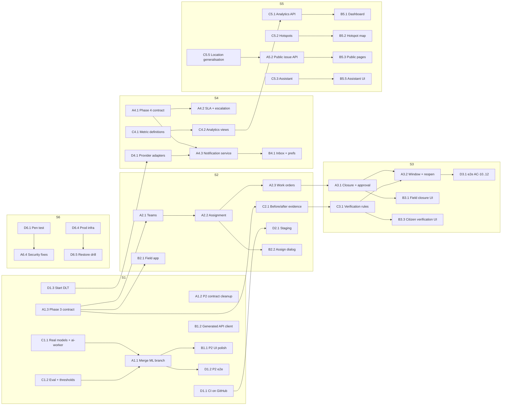

# Team plans: index and dependencies

There's one plan per person. Each lists that person's tasks **in the order they should be built**, what each task depends on, and what it unblocks for others. The overall schedule and milestones are in [`../TEAM_PLAN.md`](../TEAM_PLAN.md).

| Person | Role | Plan |
|---|---|---|
| **A** | Backend lead / tech lead | [person-a-backend.md](person-a-backend.md) |
| **B** | Frontend lead | [person-b-frontend.md](person-b-frontend.md) |
| **C** | ML and data engineer | [person-c-ml-data.md](person-c-ml-data.md) |
| **D** | Platform and QA engineer | [person-d-platform-qa.md](person-d-platform-qa.md) |

## Sprint calendar
| Sprint | Dates | Theme |
|---|---|---|
| S1 | 30 Nov – 11 Dec 2026 | Close Phase 2, open Phase 3 |
| S2 | 14 – 25 Dec | Assignment and field work |
| S3 | 28 Dec – 8 Jan 2027 | Closure and verification (holiday sprint, ~60% capacity) |
| S4 | 11 – 22 Jan | SLA, escalation, notifications |
| S5 | 25 Jan – 5 Feb | Analytics and public view |
| S6 | 8 – 19 Feb | Hardening |
| Launch | 22 – 26 Feb | Pilot go-live |

## Task ID convention
`<person><sprint>.<n>`. For example, `A2.3` is person A's third task in sprint 2. Dependencies always refer to these IDs.

---

## Critical path

These chains determine the launch date. A slip anywhere on them moves go-live unless something else is cut.

```
1. Phase 3 (operations)
   A1.3 Phase 3 contract ──► A2.1–A2.3 teams/assignment/work orders ──► A3.1–A3.2 closure + reopen ──► D3.1 e2e AC-10–12 ──► M2
                         └─► B2.1 field app (mocks) ─────────────────► B3.1–B3.3 closure/verify UI ──┘
                         └─► C2.1 evidence ──► C3.1 verification rules ───────────────────────────────┘

2. Notifications (longest external lead time)
   Decision: SMS provider (4 Dec) ──► D1.3 DLT registration (weeks) ──► D4.1 SMS adapter ──► A4.3 notification service ──► M3

3. Analytics
   C4.1 metric definitions ──► C4.2 materialized views ──► C5.1 analytics API ──► B5.1 dashboard ──► M4
   Decision: hosted LLM (25 Jan) ──► C5.3 analytics assistant

4. Environments and launch
   D1.1 CI on GitHub ──► D2.1 staging ──► (all sprint demos) ──► D6.4 production ──► D6.5 restore drill ──► 🚀
```

## Dependency graph (Mermaid, renders on GitHub)



## Contract hand-offs (who writes, who waits)

Each phase starts with an API contract in `docs/api/`. **A writes it, B and C review it within 2 working days, and B builds against it with mocks until A's endpoints land.**

| Contract | Written by | Due | Blocks |
|---|---|---|---|
| Phase 3 (teams, assignments, work orders, closure, verification) | A | S1, day 5 (4 Dec) | B2.*, C2.1, C3.1, D2.3 |
| Phase 4 (SLA, escalation, notifications) | A | End of S3 (8 Jan) | B4.*, D4.1 |
| Phase 5 (analytics, public view, exports) | A + C | End of S4 (22 Jan) | B5.* |
| Phase 6 (guest reporting, offline sync protocol, voice) | A + B | End of S5 (5 Feb) | B6.*, C6.1 |

## Product decisions that block work
| Decision | Blocks | Needed by |
|---|---|---|
| SMS provider | D1.3 → D4.1 → A4.3 | **4 Dec** |
| Pilot city, wards, categories | A launch data, D6.4 | 14 Dec |
| Closure approval policy per category | A3.1 | 21 Dec |
| SLA targets and escalation | A4.2 | 11 Jan |
| Hosted LLM allowed? | C5.3, B5.5 | 25 Jan |
| Public map precision | C5.5, A5.2, B5.3 | 25 Jan |
| Guest reporting allowed? | A6.1 | 1 Feb |
| Regional language + speech provider | B6.3, C6.1 | 1 Feb |
| Media retention periods | A6.2 | 8 Feb |
